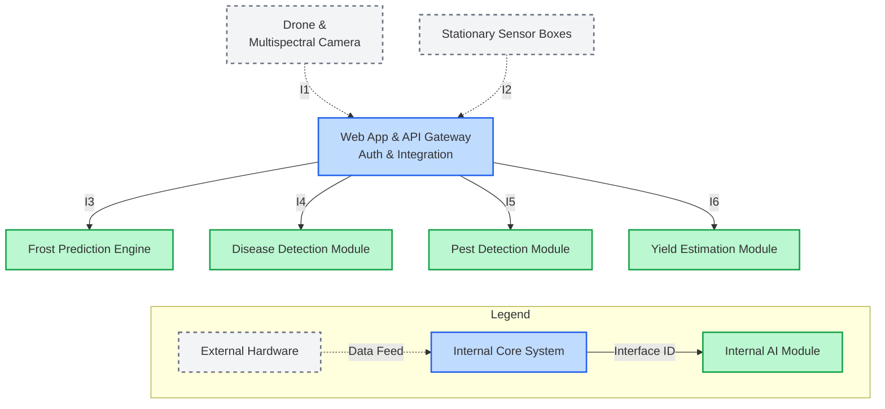
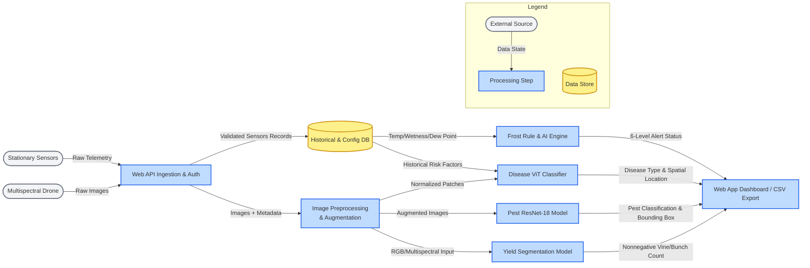

# Title, goal statement, and conventions

**Project Title:** OMID AI-Based Farm Disease, Pest, Yield, and Frost Detection System

**Team Members:** Andrea Dall'Ara, Bridget Trout, Dang Luu, Cyrus Speicher 

**Goal Statement:** Help crop farmers make timely, informed decisions by combining stationary sensor readings and drone imagery to assess frost, disease, and pest risks, estimate crop yield, and provide organized records for planning and research.

**Basic Input and Output:** The system receives timestamped sensor measurements and crop images associated with a vineyard zone, together with farmer-configured thresholds. It produces risk alerts, detected crop conditions, crop counts, yield estimates, and downloadable reports through an authenticated web application.

**Diagram Conventions:**

| Diagram | Figure or line | Meaning |
|---------|----------------|---------|
| Block diagram | Gray boxes with dashed borders | Existing drone/camera and stationary-sensor hardware supplied by the hardware team. |
| Block diagram | Blue box | The Web App & API Gateway, which provides the user-facing interface and coordinates system access and integration. |
| Block diagram | Green boxes | The four internal AI or rule-processing modules for frost, disease, pests, and yield. |
| Block diagram | Dashed arrows labeled I1 and I2 | Data feeds from external hardware into the Web App & API Gateway. |
| Block diagram | Solid arrows labeled I3 through I6 | Requests and input data sent to an internal module. The module's response uses the same interface ID, as specified in the interface table. |
| Data-flow diagram | Gray rounded figures | External sources of sensor measurements or drone imagery. |
| Data-flow diagram | Blue rectangles | Processing stages or the dashboard/export stage. These may be internal steps within a component rather than separate deployed services. |
| Data-flow diagram | Yellow cylinder | Persistent historical records and configuration data. |
| Data-flow diagram | Labeled arrows | The direction of information movement and the state or content of that information at that stage. |

Interface IDs identify connections, not execution order. Disease, pest, and yield analysis can use the same capture independently; the modules do not have to run one after another. Colors are supplemented by labels, shapes, and line styles so meaning does not depend on color alone.

The block diagram shows component boundaries; the data-flow diagram expands the processing within those boundaries. The goal statement and project title above apply to both views, and each view includes its own legend.

# Block diagram (the D0 diagram)

# Component responsibility table
| Component                | Responsibility                                                                                                          | Interfaces                        | Primary Owner |
|--------------------------|-------------------------------------------------------------------------------------------------------------------------|-----------------------------------|---------------|
| Web App & API Gateway    | Central hub for ingesting drone/sensor data, authenticating users, visualizing maps/data                             | In: I1, I2 Out: I3, I4, I5, I6 | Andrea        |
| Frost Prediction Engine  | Calculates cooling rates and freeze classifications  using a six-level rule based system to alert impending frost | In: I3 Out: I3                 | Cyrus         |
| Disease Detection Module | Uses a ViT and sensor data to classify and localize diseases                                                         | In: I4 Out: I4                 | Bridget       |
| Pest Detection Module    | Uses ResNet-18 and object detection to classify and localize vineyard pests                                          | In: I5 Out: I5                 | Bridget       |
| Yield Estimation Module  | Performs segmentation and YOLO-based bunch detection on the multispectral images to calculate crop counts         | In: I6 Out: I6                 | Dang          |

# Interface specification table
| ID | Inputs                              | Outputs                                  | Data Format    | Protocol     | Error Handling                                                                      |
|----|-------------------------------------|------------------------------------------|----------------|--------------|-------------------------------------------------------------------------------------|
| I1 | Drone Imagery                       | upload status                            | Images JSON | HTTP/REST    | WebApp rejects unsupported formats                                               |
| I2 | Sensor Data                         | ingest acknowledgement                   | JSON           | HTTP/REST    | WebApp identifies missing sensors and flags them                              |
| I3 | Sensor History Config thresholds | frost risk cooling rate               | JSON           | Internal API | Frost Engine returns erorr if sensor data is missing                             |
| I4 | Crop Images Sensor context       | disease class confidence severity  | JSON           | Internal API | Disease module returns low confidence if imagery is poor                      |
| I5 | Crop Images                         | pest class confidence bounding box | JSON           | Internal API | Pest module logs failure if image resolution is too poor to determine insects |
| I6 | Field Images                        | crop count estimated yield            | JSON           | Internal API | Yield module fails if imagery is too poor to analyze                             |

Example Payload (I2):
{
  "timestamp": "2026-10-02T12:00:00Z",
  "zone_id": "VINE_ZONE_A",
  "sensors": {
    "temperature_c": 12.4,
    "dew_point_c": 10.1,
    "leaf_wetness_pct": 85,
    "soil_moisture": 42
  },
  "battery_level": 94
}

# Data-flow diagram

# Architecture pattern and justification

**Our system uses a combination of patterns: client-server and pipeline.**

1. Client-server: Web App & API Gateway server recieves data from sensors and requests from users and sends prediction and analysis responses back to the client. There will be a backend abstracted from the user's interaction with the frontend.

2. Pipeline: Frost Prediction Engine, Disease Detection Module, Pest Detection Module, and Yield Estimation Module all follow the pipeline pattern. The sensors provide data to the backend, and particular data is routed to the appropriate analysis engine/module. That engine/module will process the data and transform it into a predicition/analysis result which is then sent to the frontend. Each engine/module is it's own independent pipeline.

**Justification:** 

- Fit to the problem: The system has a central web app interface and several specialized analysis engines/modules. Client-server fits the central hub and pipelines fit the processing of sensor data into analysis results.
- Team skills: Each team member owns one of the components based on their skillset. Andrea has full-stack development experience and so owns the web app. Cyrus has ML knowledge and web development experience and so owns frost prediction, which is tied closly to the web app. Bridget has industry experience as an ML co-op and so owns disease/pest detection. Dang has ML/AI experience and so owns yield estimation. 
- Performance and timing: Separating the ML tasks into individual modules allows computationally expensive tasks such as model inferencing, segmentation, etc. to run independently.
- Scalability: The specialized analysis modules can be scaled/developed independently without impacting other aspects of the web app. Additional analysis modules can be added easily as well.
- Hardware constraints: Since the analysis engines/modules are separate, they can be run on appropriate hardware for GPU and CPU intensive tasks.

**Rejected Pattern:**

We rejected the embedded sensor-actuator pattern because our solution's scope does not include an automatic response to sensor data. Our solution is aimed at providing accurate predictions to farmers who can then decide to take action. Our solution takes in sensor data and generates predictions / analysis content to be displayed to the user. This information helps to inform the user of possible events so that they can decide to take action if necessary. 

# Decision log

| ID | Decision | Alternatives considered | Why the chosen option won |
|----|----------|-------------------------|---------------------------|
| DL-1 | Route all hardware data and user requests through a single Web App & API Gateway. | (a) Drone and sensor boxes send data directly to each analysis module. (b) Microservices, where each module has its own API, storage, and authentication. | One entry point means login and role checks (US-03) are enforced in one place, and incoming data is validated once before any module uses it. A four-person team with a $2,000 budget cannot host and secure four separate services. The modules still sit behind their own interfaces (I3–I6), so one can be moved to separate hardware later without changing the others. |
| DL-2 | Use a six-level rule-based system for frost prediction instead of a trained model. | (a) A machine learning model trained on past temperature data. (b) Rely only on a public weather forecast service. | Frost events at a single vineyard are rare, so there is not enough local labeled data to train a reliable model. Rules based on cooling rate, temperature, and dew point are easy to explain to a farmer, use the farmer's own thresholds (I3), and run on a CPU in negligible time. Public forecasts cover a whole region, not the low spots in the vineyard where cold air settles and the sensor boxes are placed. A model can be added later behind the same I3 interface. |
| DL-3 | Keep disease detection and pest detection as two separate modules. | One combined model that detects both diseases and pests in a single pass. | The two tasks need different inputs and outputs. Disease detection combines images with sensor context (leaf wetness, humidity) and reports severity, while pest detection works from images alone and must return a bounding box for each insect (I4 vs. I5). Separate modules let each use the model that fits its task (ViT vs. ResNet-18 with object detection) and be trained, tested, and replaced independently. The cost is maintaining two models, which is acceptable because both have the same owner. |
| DL-4 | Store validated sensor records in a historical database before analysis instead of streaming readings straight to the modules. | Pass each reading directly from ingestion to the frost and disease modules and keep only the results. | The frost engine needs a history of readings to compute a cooling rate. AC-01.2 requires knowing when each sensor last reported so stale data is never shown as current. US-05 requires long-term records for research exports. Keeping the inputs also lets any prediction be traced back to the data it was based on, which supports the logging requirement in our security constraint. |
| DL-5 | Use HTTP/REST with JSON for hardware uploads (I1, I2). | (a) MQTT through a message broker. (b) Hardware writes directly into the database. | REST is the protocol the web app already uses, so there is no extra broker to host, and every upload gets an explicit acknowledgment or rejection that drives the error handling in I1 and I2. Direct database writes would bypass validation and authentication. MQTT uses less power on battery-powered sensors, so we will revisit this in D1 if field testing shows that HTTP drains the sensor batteries too quickly or the vineyard connection is unreliable. |
| DL-6 | Reuse the existing drone and multispectral camera. | (a) Buy a new drone with a standard RGB camera. (b) Use free satellite imagery. | The $2,000 budget covers the whole system, so reusing hardware leaves money for sensor-box weatherproofing, calibration, and security, which our constraints essay ranks as essential. Multispectral bands show plant-health signals that RGB alone does not, which helps disease detection and yield segmentation. Free satellite imagery has a resolution of about 10 m per pixel, which is too coarse to see individual bunches, leaves, or insects, and cloud cover leaves gaps between images. |

# AI Attribution
The authors would like to acknowledge the use of Gemini, 
developed by Google, in the preparation of this assignment. 
Gemini was used in the following way(s) in this assignment: 
Style and layout of the mermaid block diagram (D0) and the
data-flow diagram. 
