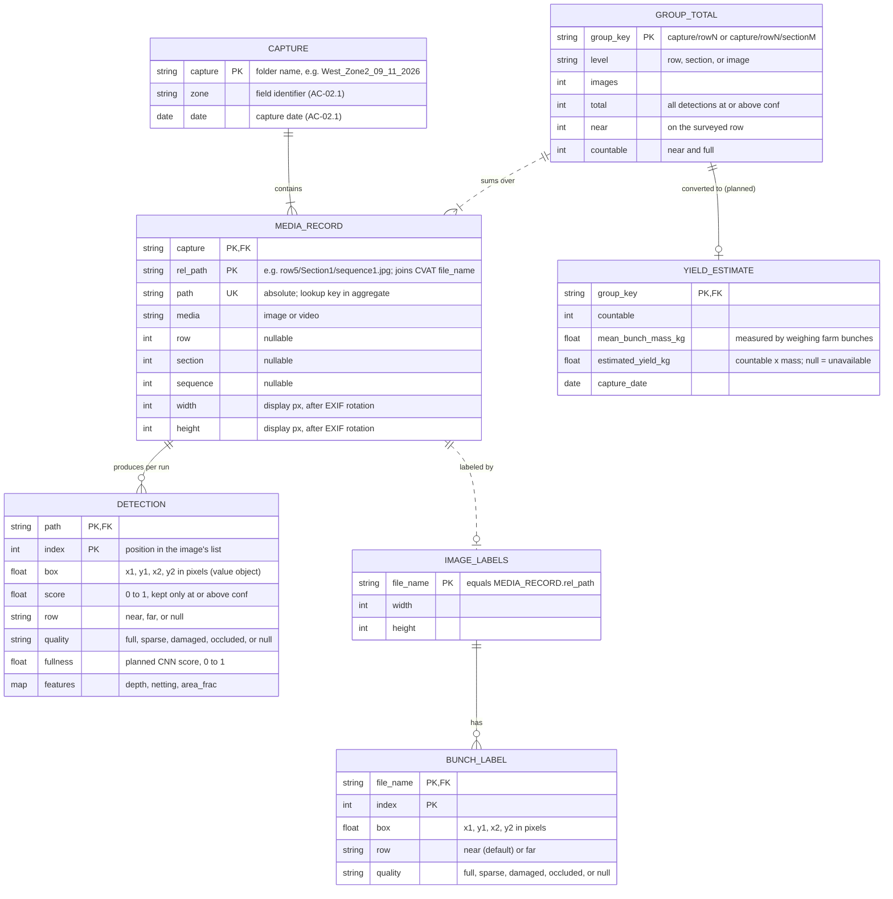

# Header, scope, and conventions
**Project Title:** OMID AI-Based Farm Disease, Pest, Yield, and Frost Detection System

**Team Members:** Andrea Dall'Ara, Bridget Trout, Dang Luu, Cyrus Speicher

**Goal Statement:** Help crop farmers make timely, informed decisions by combining stationary sensor readings and drone imagery to assess frost, disease, and pest risks, estimate crop yield, and provide organized records for planning and research.

**Scope:**
D0 Components in this document: Web app, Disease Detection, Pest Detection, Yield Estimation
D0 Components deferred to D2: Frost Prediction

## Yield Estimation figure conventions

| Figure element | Meaning |
|---|---|
| Box | One entity: a record type the yield module stores or produces. The title is the entity name; each line inside is one key attribute as `type name`, followed by a note in quotes. |
| `PK`, `FK`, `UK` after an attribute | Primary key, foreign key, unique key. Two `PK` marks in one box form a composite key. |
| "planned" in a box or note | Designed but not yet in code. Everything else exists in `grapevision/`. |
| Solid line | Identifying relationship: the child cannot exist without the parent (a detection without its photo). |
| Dashed line | Non-identifying relationship: the two records are matched by a key value (labels to photos by `rel_path`, totals to photos by `group_key`). |
| Line label | The relationship, read from the left entity to the right one. |
| Line ends (crow's foot) | Cardinality is drawn on both ends: `\|\|` exactly one, `o\|` zero or one, `\|{` one or more, `o{` zero or more. |

# Data model, the D1 diagram

## Yield Estimation

**Source:** `grapevision/data/catalog.py`, `data/annotations.py`, `types.py`, `count/pipeline.py`.



| Structural decision | Reason |
|---|---|
| `CAPTURE` is an entity, not just a folder string. | It carries the field identifier (`zone`) and capture date that every count and yield must display (AC-02.1, AC-04.1). Both are parsed once from the folder name `<zone>_<MM>_<DD>_<YYYY>`. In the stored catalog they are repeated on each photo's row, since one CSV covers one or a few captures. |
| Row and section are attributes of `MEDIA_RECORD`, not entities. | They have no data of their own yet; they only group photos. `group_key(level)` derives the group ID on demand, so one catalog serves row, section, and image totals and the leakage-free train/val/test splits. |
| A box is a value object inside `DETECTION` and `BUNCH_LABEL`. | A box has no identity: two boxes with the same coordinates are interchangeable. It is a frozen, hashable `Box` with IoU, clipping, and YOLO conversion on it. |
| `DETECTION` is its own entity, one-to-many from the photo, and is kept after counting. | Every count is a sum over detections. Keeping each one with its `row`, `quality`, and `features` shows which stage removed a bunch (`total − near` = background row, `near − countable` = not full) and provides training data for the planned learned row filter. Zero detections is a valid count of 0. |
| Labels (`IMAGE_LABELS`, `BUNCH_LABEL`) are separate from `DETECTION`. | Ground truth and predictions change on different schedules (CVAT exports vs. model runs) and the evaluation compares the two. It is zero-or-one per photo because most photos are never labeled. |
| `row` and `quality` are plain strings from a fixed vocabulary, validated on import. | They round-trip unchanged through CVAT attributes, CSV, and JSON. An unknown value raises `ValueError`, so a typo in the labeling setup cannot become a new class. `occluded` is kept apart from `sparse` so a quality model does not learn that "partly hidden" means "sparse". |
| `GROUP_TOTAL` to photos is one-to-many, not many-to-many. | At a given level each photo sits in exactly one row and section folder. Many-to-many would arise only if shots overlapped across sections, which the aggregation assumes they do not (see Core algorithms, edge cases). |
| `YIELD_ESTIMATE` is zero-or-one per group, and its yield is nullable. | When no measured bunch mass is configured, the yield is reported as unavailable (null), never as 0 (AC-04.2). A real zero (photos read, no countable bunches) stays 0 kg. |
| Key fields used for lookups. | `rel_path` is the join key with CVAT's `file_name` (a hash map in `export_dataset.py`; a labeled file not found on disk stops the export with an error). The resolved absolute `path` is the hash key in `aggregate`, so matching each result is O(1). `group_key` is the bucket key for splits and totals. |

**Store choice: flat files, not a relational database.** The module keeps `catalog.csv`, `per_image.csv`, and `per_<level>.csv`, the CVAT COCO JSON for labels, and YAML for configuration. One capture is about 22 photos and a season is at most a few thousand rows. There is one writer (a batch script), no concurrent updates, and no ad-hoc queries. CSV opens in a spreadsheet and matches the research-export format (AC-05.1), and there is no database server to host. Once several seasons and fields need joins, the entities above map one-to-one onto SQLite tables with the keys as drawn.

# Core algorithms

## 1. Single-photo disease classification

**Source:** `docker_app/backend/main.py`, `leaf_preprocess.py`.

```text
Decode the uploaded image.
Build leaf, lesion, dark-mark, and edge masks using OpenCV.
Stack grayscale, combined lesion/dark-mark mask, and edges; resize to 224x224.
Apply the saved image processor and run the ViT model in evaluation mode.
Apply softmax; return the highest-scoring label and up to three ranked classes.
Round confidence values to four decimal places.
```

Leaf preprocessing is enabled by default and can be disabled through `DISABLE_LEAF_PREPROCESS`. Flutter labels confidence as high above 0.85, moderate above 0.6, and low otherwise. These labels describe confidence, not disease severity. The backend always returns its top class.

## 2. Multispectral disease analysis

**Source:** `application/Docker/Multispectral_Container/`.

```text
Save at least five TIFF uploads using a supplied or generated capture ID.
Sort bands and align them to the third image using ORB matches and a homography.
Generate the band collage, spectral-index previews, and statistics.
Read the five aligned bands as blue, green, red, NIR, and red-edge.
Compute NDVI = (NIR-red)/(NIR+red+1e-6).
Compute NDRE = (NIR-redEdge)/(NIR+redEdge+1e-6).
Normalize the resulting seven channels using saved means and standard deviations.
For each complete 64x64 tile, with stride 32:
    Skip tiles with vine ResNet-18 probability below 0.5.
    Run the distilled disease ResNet-18 and accumulate its probability heatmap.
    For disease probability >= 0.9, count a positive tile and generate CAM boxes.
Set disease_detected to whether any disease-positive tile exists.
Save visualization PNGs and a JSON summary.
Upload generated JPG/PNG/JSON outputs, make them public, and write Firestore metadata.
Optionally clean local files, then return the completed result.
```

Missing reference-image features stop alignment; failed alignment of another band retains that band's original image. Band order comes from filenames. No qualifying vine tiles produces `disease_detected: false`. CAM boxes are drawn into images rather than returned as structured detections. Processing completes within the HTTP request; uploads and the Firestore write are separate operations.

## 3. Pest classification

**Source:** `application/pest_detection_backend/main.py`.

```text
Decode the image to RGB and scale pixels to [0,1].
Normalize channels using mean [0.485,0.456,0.406] and std [0.229,0.224,0.225].
Run the CPU ResNet-18 in evaluation mode without gradients.
Apply softmax across six classes and return the top label and confidence.
Return HTTP 500 with error text if processing raises an exception.
```

The endpoint performs no resizing or confidence rejection. Its exact labels are `Adult Spotted Laternfly`, `Early Nypmh Spotted Laternfly`, `Green Leafhopper`, `No Pests`, `Japanese Beetle`, and `Late Nypmh Spotted Laternfly`.

## 4. Web app data access

**Source:** Flutter `mobile_dashboard.dart`, `historical_series_service.dart`, `organization_service.dart`; Functions `getHistoricalSeries.js` and `lib/http.js`.

- **Captures:** Stream the top-level Firestore `captures` collection ordered by descending timestamp, optionally filtering `detected_disease == true`. The query has no organization/site/zone filter or pagination. Individual photo results remain in widget state.
- **History:** Verify the Firebase token and organization membership document; validate required fields; query BigQuery by organization, site, zones, readings, and inclusive time bounds. Aggregate by time bucket and return chart series. Use `sensorId` when supplied, otherwise primary-sensor readings. Flutter converts timestamps to local time and sorts points.
- **Roles:** The Flutter service checks `canManageMembers`, rejects self-role changes, requires an existing target member, and restricts owner changes to owners. It checks the remaining owner count before demotion, then updates role-derived permissions directly in Firestore. Checks and writes are separate, nontransactional operations.

## 5. Yield counting pipeline

**Source:** `grapevision/count/pipeline.py`, `detect/infer.py`, `rowfilter/filter.py`, `quality/classifier.py`.

**Change from D0.** D0 described segmentation on multispectral drone images. The module now detects bunches as boxes in RGB photos taken from the side of the row. Bunches hang in the fruiting zone under the canopy, so an overhead view sees mostly leaves. The public training sets (Zenodo, CERTH) and our farm captures are RGB. Counting needs one instance per bunch, which box labels give at a fraction of the labeling time of masks.

**What it is and the problem it solves.** It turns a set of row photos into the number of bunches that count toward yield, per row or per section, and then into an estimated yield in kilograms (US-02, AC-02.1, I6). A plain detector count is wrong in three ways: it counts bunches on the row behind, seen through gaps in the canopy; it counts small or sparse bunches the farm leaves out of its yield; and it misses small bunches when a 1215×911 photo is shrunk to the model's 640 px input.

```text
For each photo in the catalog:
    Load it as RGB with the EXIF rotation applied.
    Detect: SAHI cuts the photo into 640x640 tiles with 25% overlap (6 tiles at 1215x911),
        runs YOLO11 on each tile and on the whole photo, and merges duplicate boxes
        (non-maximum merging when half of the smaller box lies inside the larger).
        Keep detections with score >= conf (tuned on the val split, algorithm 6).
    Row filter (skipped when there are no detections):
        Run Depth Anything V2 once; take the median depth over the central 50% of each box.
        Split the box depths into two groups with 1-D Otsu.
        If separability >= 0.85, the closer group is near and the other far; otherwise all are near.
    Quality: judge each near-row detection full or not
        (current baselines: accept all, or box area >= 0.2% of the photo; a fullness CNN is planned).
    Count: total, near, and countable (near and full).
Sum the three counts per row or section key.
Planned: estimated_yield_kg = countable x mean_bunch_mass_kg for each group.
```

**Inputs and outputs.**

- `CountingPipeline.run(image_path: str | Path) -> ImageResult`. `ImageResult.detections` is a `list[Detection]`; its `total`, `near`, and `countable` properties are `int ≥ 0`.
- `aggregate(results: Iterable[ImageResult], records: Iterable[MediaRecord], level: str = "row") -> dict[str, dict[str, int]]`, where `level` is `"row"`, `"section"`, or `"image"`. Each value has the keys `images`, `total`, `near`, `countable`, for example `{"West_Zone2_09_11_2026/row5": {"images": 11, "total": 312, "near": 240, "countable": 171}}`.
- Settings: `detector.conf: float` in [0, 1]; `row_filter.min_separability: float` in [0, 1] (default 0.85); `quality.min_area_frac: float` in (0, 1) (default 0.002).
- Planned yield step: `mean_bunch_mass_kg: float > 0`, the mean mass of bunches harvested and weighed on the farm, stored in the project config. The output is `estimated_yield_kg: float ≥ 0`, or `None` when no mass is configured.

**Complexity.** Our realistic size today is one capture: 22 photos (2 rows × 4 sections × 2–3 shots) with tens of boxes per photo. The cost per photo is set by model passes, not by the number of bunches: 7 YOLO11m passes (6 tiles plus the whole photo) and 1 Depth Anything pass. Everything else is small. Otsu is O(n²) in boxes per photo (about 900 steps at n = 30), the quality baselines are O(n), and `aggregate` is O(N) with one hash lookup per photo, so a run is O(N) in photos. Estimated, not yet measured: roughly 0.5–1.5 s per photo on a laptop GPU (the depth model runs on CPU by default), so under a minute for 22 photos. At 100 times the size (2,200 photos, a whole block over several dates) that is about 20–55 minutes on a GPU and 1–2 hours on CPU only. The difference matters only if a farm worker waits for the result. As a batch job after each survey it is acceptable, so we will measure before optimizing. If boxes per photo grow by 100 times (video frames, dense canopy), Otsu drops to O(n log n) with prefix sums.

**Why this approach rather than the alternatives.**

- *Detect first, then filter, rather than a detector with a "countable" class.* Whether a bunch counts depends on context (which row it is on, how full it is), which a detector learns poorly from a few dozen labeled photos. Separate stages share one interface, `apply(image, detections)`, so each can be tested and replaced alone, and the three counts show which stage removed which bunches.
- *SAHI tiling rather than one pass at 640 px.* Shrinking a 1215 px photo to 640 px halves every bunch. Tiling costs 7 passes instead of 1, which the complexity estimate above shows is affordable.
- *Per-photo Otsu on relative depth rather than a fixed depth cutoff.* Depth from one photo is relative, so values cannot be compared across photos. The question "are there two distinct depth layers in this photo?" can be answered per photo. The 0.85 cutoff keeps a single row shot at an angle (evenly spread depths, separability about 0.75) from being split in half. Blue bird netting is recorded as a feature but not used as the rule, because most rows have no netting.
- *Deep detector rather than the team's traditional-ML pipeline* (HSV colour proposals with SVM/XGBoost classifiers, in the repository). Colour thresholds shift with the late-season yellow leaves and blue netting in the West_Zone2 capture.

**Edge cases.**

| Case | Behavior | Tied to |
|---|---|---|
| Empty input (no photos in the catalog) | `aggregate` returns `{}`; no group and no yield is reported, rather than a count of 0. | AC-02.2 |
| Unreadable or unsupported file | Non-image extensions are skipped when the catalog is built. A corrupt image makes `load_image` raise, which currently stops the run; it must be caught and reported by file name before integration, so no count is shown for a failed analysis. | AC-02.2 |
| Photo with no detections | Valid count of 0; the depth model is not run. | AC-02.1 |
| Fewer than two boxes, or all at the same depth | Otsu returns separability 0, so every box is near. The filter removes a bunch only when it has evidence. | — |
| Box with no depth value (NaN) | Treated as near. | — |
| Duplicates inside one photo | Overlapping tiles see the same bunch twice; NMM merges them into one box. Two touching bunches can be merged into one, an undercount; the merge threshold is tunable. | — |
| Duplicates across photos | Overlapping consecutive shots count a bunch twice. `aggregate` assumes shots in a section do not overlap; tracking bunches across video frames is the planned fix. | AC-02.1 |
| Result whose photo is not in the catalog | `KeyError` naming the file. Silently dropping it would undercount a row. | — |
| Ties | Otsu keeps the first split with the largest between-group variance, so results are deterministic. A score exactly equal to `conf` is kept (`>=`). | — |
| Unknown `row_filter.method` or `quality.method` | `ValueError` when the pipeline is built, before any photo is processed. | — |
| No measured bunch mass configured | `estimated_yield_kg` is null and shown as unavailable, never 0. | AC-04.2 |

## 6. Confidence-threshold tuning for counts

**Source:** `grapevision/eval/metrics.py` (`tune_threshold`, `sweep_thresholds`, `count_metrics`).

**What it is and the problem it solves.** The detector's confidence cutoff (`detector.conf`) decides the count directly: too low overcounts, too high undercounts, and the error carries into every row total and yield (AC-02.1, AC-04.1). The earlier notebook picked its cutoff on its 9-photo test set and reported the best of 16 tries on that same set, which gave an optimistic error. This algorithm picks the cutoff on the val split only.

```text
Run the detector once on every val photo with conf_floor 0.05; keep every score.
For each threshold t in 0.05, 0.10, ..., 0.95:
    predicted count of photo i = number of its scores >= t
    compute MAE, RMSE, bias, exact %, within-1 % against the labeled counts
Choose the t with the lowest MAE; on a tie, choose the higher t.
Report test-split metrics at that fixed t, with a bootstrap confidence interval on MAE.
```

**Inputs and outputs.** `tune_threshold(true_counts: Sequence[int], scores_per_image: Sequence[Sequence[float]], thresholds: Sequence[float] | None = None, objective: str = "mae") -> tuple[float, list[dict[str, float]]]`. `true_counts[i] ≥ 0` is the labeled count for val photo `i`: countable bunches when tuning the yield count, all bunches when tuning the detector alone. `scores_per_image[i]` holds that photo's detection scores in [0, 1]. `objective` is any lower-is-better key of `count_metrics` (`mae`, `rmse`). It returns the chosen threshold and the full table, one row per threshold with `n`, `mae`, `rmse`, `bias`, `exact_pct`, `within1_pct`, `total_true`, `total_pred`, and `threshold`.

**Complexity.** O(T·S) for T thresholds and S stored scores. Inference is not in the loop, because it ran once beforehand. Today that is 19 thresholds over about 6 val photos with tens of scores each, around 10³ operations. At 100 times it is about 10⁵, still milliseconds. The size does not matter here; the inference pass before it does.

**Why this approach rather than the alternatives.** Ultralytics' default 0.25 was chosen for COCO box accuracy, not for our counts. Maximizing box F1 optimizes a different target: in the earlier notebook, tuning brought farm-photo count error from 8.6 down to 3.4 while box recall stayed near 0.3, because extra false boxes offset missed ones. Both kinds of metric are reported for that reason. Tuning on the test split leaks the answer into the score. Signed bias is reported alongside MAE because per-photo errors cancel out over a row total, but bias does not, and the yield figure is a row total.

**Edge cases.** An empty val split or `true_counts` and `scores_per_image` of different lengths raise `ValueError`. A photo with no detections predicts 0 at every threshold. Ties go to the higher threshold, which keeps fewer low-confidence boxes. An unknown `objective` raises `KeyError`. A val split of about 6 photos gives a wide bootstrap interval, which is reported rather than hidden; group k-fold by section (`group_kfold`) gives a steadier estimate while labeled data is small.

# Build-versus-reuse decisions

## Yield Estimation

| Piece | Build or reuse | Library or service | License | Reason |
|---|---|---|---|---|
| Bunch detector and its training loop | Reuse | Ultralytics YOLO11 (`yolo11m` pretrained weights) | AGPL-3.0 | Mature and actively released; the team already trained it in the earlier notebook; fits a 6 GB GPU (`yolo11s` if memory runs short). See the license note below. |
| Tiled inference and box merging | Reuse | SAHI | MIT | Published method (ICIP 2022) with native Ultralytics support; it merges boxes cut by tile seams, which hand-rolled tiling would get wrong. |
| Depth estimation for the row filter | Reuse | Depth Anything V2 Small, through Hugging Face `transformers` | Apache-2.0 (Small checkpoint and `transformers`) | NeurIPS 2024 model; about 25M parameters, so it runs on CPU; needs no extra hardware. The Base and Large checkpoints are CC BY-NC 4.0, so we stay on Small. |
| Tensor runtime | Reuse | PyTorch | BSD-3-Clause | Required by both models; CUDA builds for training, CPU builds for testing. |
| Image loading, EXIF rotation, drawing | Reuse | Pillow | MIT-CMU (HPND) | `ImageOps.exif_transpose` fixes sideways phone photos, which would otherwise put boxes on a rotated grid. |
| Array math | Reuse | NumPy | BSD-3-Clause | Depth medians, Otsu, and metrics are a few vectorized lines. |
| Configuration | Reuse, plus a small build | PyYAML, with our 15-line layered merge | MIT | Hydra or OmegaConf would add a framework for three config layers. |
| Labeling tool | Reuse | CVAT | MIT | Free and self-hostable; supports per-box attributes (`row`, `quality`) and exports COCO. |
| Training images | Reuse | Zenodo Grapevine Bunch Detection, CERTH Grape Dataset | CC BY 4.0 | Attribution only. The Embrapa WGISD set was dropped because it is CC BY-NC 4.0. |
| Capture catalog and section/row splits | Build | — | — | Specific to our `<capture>/rowN/SectionM/sequenceK` layout. scikit-learn's `GroupShuffleSplit` sizes splits by group count, not image count, and makes two-way splits only. Our greedy fill hits train/val/test image ratios in one pass. |
| CVAT import and YOLO export | Build | — | — | Must carry the `row` and `quality` attributes and flatten paths to collision-free file names; Ultralytics' COCO converter ignores per-box attributes. |
| Near/far rule (Otsu split) | Build | — | — | scikit-image's `threshold_otsu` returns only the threshold; we also need the separability score and NaN handling. About 30 lines. |
| Quality baselines and stage interface | Build | — | — | The definition of "countable" (near row and full) is specific to this farm. |
| Fullness classifier (planned) | Reuse the backbone, build the training | torchvision EfficientNet-B0 | BSD-3-Clause | Small pretrained model that can learn from a few hundred bunch crops. |
| Aggregation and yield formula | Build | — | — | A few lines, tied to the farm's definition of yield. |
| Count metrics, box matching, threshold tuning | Build | — | — | pycocotools and torchmetrics report mAP, not count MAE or bias. Box matching is 15 lines. `scipy.stats.bootstrap` could replace our bootstrap, but it is not worth a SciPy dependency. |
| Tests, lint, type checks, CI | Reuse | pytest, ruff, mypy, GitHub Actions | MIT (tools); Actions free tier | Runs on every pull request with a 90% coverage gate, without a GPU. |

**License note.** Ultralytics code and weights are AGPL-3.0. Running a modified version as a network service requires offering its full source to users, or buying an Ultralytics Enterprise license. Our code is open in the team repository, so academic use complies. If OMID needs a closed deployment, RT-DETR in Hugging Face `transformers` (Apache-2.0) can replace it behind the same detector interface, a callable from image to `list[Detection]`.

# API contract

Each Python service has its own base URL; `getHistoricalSeries` is a Firebase HTTPS function. Image requests use multipart form data; history uses JSON with a Firebase bearer token. The Python handlers have no application-level authentication checks. Responses retain each service's existing field names and structure.

## Endpoints

| Method / route | Input | Success | Errors |
|---|---|---|---|
| `POST /predict` | Required multipart `file`: image. | `200`: `DiseaseResponse`. | `422` for a missing file; processing exceptions have no custom error response. |
| `POST /pests_predict` | Required multipart `file`: image. | `200`: `PestResponse`. | `422` for a missing file; caught exceptions return `500` with `{success:false,error:string}`. |
| `POST /process-capture` | Repeated multipart `files`: TIFFs; optional `capture_id: string`. | `200`: `CaptureResponse` after processing/upload. | `400` for no uploads or fewer than five accepted files. Pipeline exceptions return `500` with `{error:string,capture_id:string}`; file-saving exceptions fall outside this catch. |
| `POST /getHistoricalSeries` | Bearer token; JSON `HistoryRequest`. | `200`: `HistoryResponse`. | `400` invalid/missing required fields; `401` invalid token; `403` absent membership; `500` caught exception. Error body: `{success:false,error:string}`. `OPTIONS`: `204`; other methods: `405`. |
| `GET /health` (photo disease) | None. | `200`: `{"status":"ok"}`. | No custom failure branch. |
| `GET /healthz` (multispectral) | None. | `200`: `{"ok":true}`. | No custom failure branch. |

Multispectral uploads skip unsupported extensions/empty filenames and require at least five saved TIFFs. Files must follow the expected band ordering. The application defines no upload-size limit or duplicate-request protection. The image clients do not implement automatic retries or job polling.

## Data types

`?` marks optional inputs. Types describe the actual payload shapes; they do not imply additional runtime validation.

| Type | Fields |
|---|---|
| `DiseaseResponse` | `disease: string`, `confidence: number`, `top3: {disease: string, confidence: number}[]`. |
| `PestResponse` | `success: true`, `prediction: string`, `confidence: number`. |
| `CaptureResponse` | `capture_id: string`, `aligned_dir: string`, `processed_dir: string`, `inference_dir: string`, `inference_summary: InferenceSummary`, `firebase_upload: UploadSummary`, `cleanup: boolean`. Directory fields are server-local paths. |
| `InferenceSummary` | `device: string`, `disease_detected: boolean`, `analysis_label: integer` (0/1), `max_disease_probability: number`, `vine_positive_tiles: integer`, `disease_positive_tiles: integer`, `output_files: {overlay: string, heatmap: string, boxes: string}` (local paths). |
| `UploadSummary` | `firestore_document: string`, `processed_urls: map<string,string>`, `inference_urls: map<string,string>`. Maps associate filenames with public URLs. |
| `HistoryRequest` | `organizationId: string`, `siteId: string`, `zoneIds: string[]`, `readings: string[]`, `start: string`, `end: string`, `interval?: string`, `sensorId?: string`, `timezone?: string`, `aggregation?: string`. Arrays must be nonempty; dates must be parseable. |
| `HistoryResponse` | `success: true`, `interval: string`, `aggregation: string`, `graphs: Graph[]`. No matching rows returns `graphs: []`. |
| `Graph` | `field: string`, `unit: string\|null`, `series: {zoneId: string, points: {t: string, v: number}[]}[]`. Each point contains a bucket timestamp and aggregated value. |

History intervals are `MINUTE_15`, `MINUTE_30`, `HOUR`, `DAY`, `WEEK`, or `MONTH`. Automatic selection uses `MINUTE_30` for ranges up to three days, `HOUR` up to five days, and `DAY` above five days. Aggregation accepts `AVG`, `MIN`, or `MAX`, defaulting to `AVG`; timezone defaults to `America/New_York`. Unrecognized intervals use automatic selection. The handler checks neither start-before-end nor site/zone parentage and defines no range/point-count limit.

## Direct Firestore operations

| Operation | Contract |
|---|---|
| Save capture | `.set()` on `captures/{capture_id}` writes `capture_id: string`, `timestamp: server timestamp`, `raw_folder_name: string`, `detected_disease: boolean`, `analysis: InferenceSummary`, and the two URL maps. Existing contents are replaced. No organization/site/zone fields are written. Failures propagate to the pipeline handler. |
| Stream captures | `.snapshots()` returns live documents using the filter/order described in Core algorithms. The dashboard shows loading/empty states but has no explicit `snapshot.hasError` branch. |
| Update role | `updateMemberRole(orgId: String, userId: String, newRole: String)` returns `Future<void>` and updates `role` plus boolean permissions `canManageMembers`, `canManageSites`, and `canManageSensors`. Failed checks throw exceptions; SDK errors propagate. Owners/admins receive all permissions, members receive site/sensor permissions, and viewers receive none. |

## Example payload

For `POST /pests_predict`, send a multipart part named `file` containing the image. An illustrative `200` response is:

```json
{
  "success": true,
  "prediction": "Japanese Beetle",
  "confidence": 0.93
}
```

A caught processing exception instead returns `500` with `{"success":false,"error":"<exception text>"}`. Flutter displays the prediction on success or an error message on failure.

# Technology choices with justification

## Yield Estimation

**Detector: YOLO11 (Ultralytics) with SAHI tiling.**
- *Team skill fit:* Dang, who owns this module, works in deep learning, and the team already trained YOLO11 in the earlier notebook, so the training loop, augmentation settings, and checkpoint format are known.
- *Licensing:* Ultralytics is AGPL-3.0, which is acceptable for an open academic repository and has an Apache-2.0 fallback (see the license note above). SAHI is MIT.
- *Community support:* Ultralytics is one of the most widely used detection libraries, with frequent releases, extensive documentation, and active issue tracking. SAHI is a peer-reviewed method (ICIP 2022) with built-in Ultralytics support.
- *Performance:* YOLO11m has 20.1M parameters and scores 51.5 mAP50-95 on COCO. The 7 passes per photo fit the batch budget in the complexity estimate.
- *Cost and hosting:* both are free. Training fits a 6 GB laptop GPU or free Google Colab, and inference also runs on CPU when no GPU is available.
- *Alternatives passed over:* the team's traditional-ML pipeline (HSV colour proposals with SVM/XGBoost) runs on CPU and is explainable with SHAP, but its colour thresholds shift with late-season yellow leaves and blue netting. Faster R-CNN in torchvision (BSD) would avoid the AGPL license, but it is slower, and we have no training code for it.

**Row filter: Depth Anything V2 Small.**
- *Team skill fit:* it is one call through the Hugging Face `transformers` pipeline API and needs no 3D-vision background.
- *Licensing:* the Small checkpoint is Apache-2.0. The larger checkpoints are CC BY-NC 4.0 and are excluded.
- *Community support:* it is a NeurIPS 2024 model hosted on the Hugging Face Hub and widely adopted for monocular depth.
- *Performance:* about 25M parameters and one pass per photo. Relative depth is enough, because the rule only orders boxes within one photo, and rows 2.5–3 m apart against a camera about 1 m from the canopy give two well-separated depth layers.
- *Cost and hosting:* the weights are about 100 MB and run on CPU, with no new hardware.
- *Alternatives passed over:* a stereo or depth camera (for example an Intel RealSense) gives metric depth, but it spends hardware money from the $2,000 budget (DL-6) and changes how photos are captured. A rule based only on netting colour works only on netted rows.

**Language and packaging: a typed Python package with command-line scripts, replacing the notebook.**
- *Team skill fit:* every team member writes Python, and the disease and pest services are already Python.
- *Licensing:* Python is under the PSF license. Every core dependency (NumPy, Pillow, PyYAML) is permissive, and the GPU libraries are optional extras.
- *Community support:* Python has the largest machine-learning ecosystem, and pytest, ruff, and mypy are standard tools.
- *Performance:* Python only orchestrates; the heavy work runs in PyTorch and NumPy compiled code.
- *Cost and hosting:* free. CI runs on the GitHub Actions free tier on Linux and Windows, with strict type checks and a 90% coverage gate, and installs as a wheel anywhere.
- *Alternative passed over:* keeping the Jupyter notebook. Its hidden cell state cannot be unit-tested in CI, and the notebook's `fork` multiprocessing setting fails on Windows.

**Storage: CSV, COCO JSON, and YAML files.**
- *Team skill fit:* no database administration is needed, and anyone on the team or at the farm can open a CSV.
- *Licensing:* open formats read by the Python standard library, with no license.
- *Community support:* universal tooling (spreadsheets, pandas, CVAT export).
- *Performance:* a season of a few thousand rows loads in milliseconds, and lookups use in-memory hash maps keyed as in the data model.
- *Cost and hosting:* nothing to host or pay for; the files sit with the run outputs and can be versioned.
- *Alternatives passed over:* SQLite (public domain) would allow queries across seasons, but nothing needs them yet. The web app's Firestore and BigQuery are where results reach users, while inside this module files keep the batch pipeline free of network access and credentials.

**Compute and hosting: a 6 GB laptop GPU or Google Colab for training, and batch inference on the same machine.**
- *Team skill fit:* the team has already run CUDA training locally and on Colab; the earlier notebook supports both.
- *Licensing:* the CUDA drivers and toolkit are free under NVIDIA's license, Colab's free tier is under Google's terms, and our code is unaffected by either.
- *Community support:* PyTorch publishes CUDA builds for Windows and Linux, and Ultralytics documents low-memory settings (`batch=-1`).
- *Performance:* in the complexity estimate, 22 photos take under a minute and 2,200 photos under an hour on a GPU. Every model also runs on CPU, so a GPU is never required.
- *Cost and hosting:* $0 with owned hardware and free Colab.
- *Alternative passed over:* a cloud GPU such as an AWS T4 instance (about $0.50 per hour). It is affordable for batch jobs but adds account setup, credentials, and a recurring cost against the budget, so we keep it as a fallback only.
