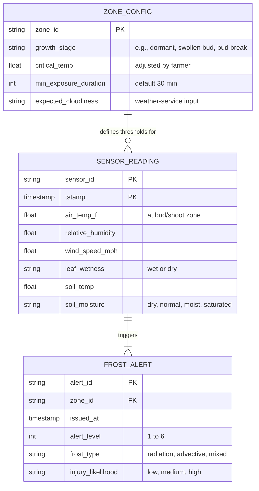
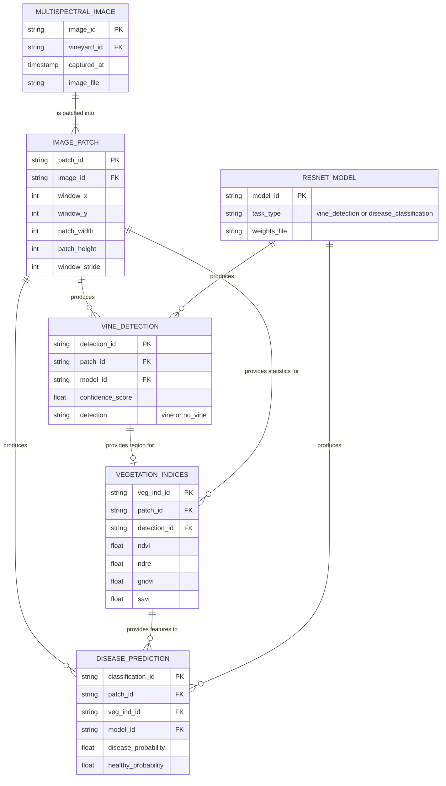

# Header, conventions, and D2 overview
**Project Title:** OMID AI-Based Farm Disease, Pest, Yield, and Frost Detection System

**Team Members:** Andrea Dall'Ara, Bridget Trout, Dang Luu, Cyrus Speicher

**Goal Statement:** Help crop farmers make timely, informed decisions by combining stationary sensor readings and drone imagery to assess frost, disease, and pest risks, estimate crop 
yield, and provide organized records for planning and research.

# Finished components, the D2 diagrams

## For the Frost Prediction Engine (Rule-based Model)
### Data Model
**Frost Data Model Conventions**

| Figure element | Meaning |
|---|---|
| Box | One entity. The title is the entity name; each line inside is one key attribute. |
| `PK`, `FK` | Primary key, foreign key. |
| Solid line | Identifying relationship (the child cannot exist without the parent). |
| Dashed line | Non-identifying relationship. |
| Line ends (crow's foot) | Cardinality: `\|\|` exactly one, `o\|` zero or one, `\|{` one or more, `o{` zero or more. |

**Project Title:** OMID AI-Based Farm Disease, Pest, Yield, and Frost Detection System 
**Goal Statement:** Help crop farmers make timely, informed decisions by combining stationary sensor readings and drone imagery to assess frost, disease, and pest risks, estimate crop yield, and provide organized records for planning and research.

### Behavior (State Machine):
Every 15 minutes the following derived variables are calculated by the engine: 
**Cooling rate:** calculated over previous timeframes 
$$CoolingRate_{60} = T_{now} - T_{60min}$$ 
**Dew point (magnus approximation):** Where a = 17.625 and b = 243.04°C 
$$\gamma = \ln\left(\frac{RH}{100}\right) + \frac{aT}{b+T}$$ 
$$T_d = \frac{b\gamma}{a-\gamma}$$ 
**Dew point spread:** 
$$DewPointSpread = T_{air} - T_{dewpoint}$$ 
**Projected temperature:** 
$$T_{projected,2h} = T_{now} + 2(CoolingRate_{60})$$ 

**Frost State Machine Conventions**

| Figure element | Meaning |
|---|---|
| Black circle | The initial or terminal state of the system. |
| Gray rounded box | A specific operational alert level (state). |
| Red rounded box | An explicit error-handling or degraded state. |
| Solid arrow | A state transition triggered by new sensor readings or time passing. |
| Dashed arrow | An error path triggered by missing inputs, invalid boundary values, or timing timeouts |
| Text on arrow | The specific rule conditions and thresholds required to trigger the transition. |

**Project Title:** OMID AI-Based Farm Disease, Pest, Yield, and Frost Detection System 
**Goal Statement:** Help crop farmers make timely, informed decisions by combining stationary sensor readings and drone imagery to assess frost, disease, and pest risks, estimate crop yield, and provide organized records for planning and research.

```mermaid
flowchart TB
    %% Styling to mimic state machine shapes
    classDef state fill:#f3f4f6,stroke:#374151,stroke-width:2px,rx:10px,ry:10px;
    classDef errorState fill:#fee2e2,stroke:#dc2626,stroke-width:2px,rx:10px,ry:10px;
    classDef point fill:#000,stroke:#000,rx:20px,ry:20px;

    Start((( ))):::point
    End((( ))):::point

    L1["Level 1: Normal"]:::state
    L2["Level 2: Frost Watch"]:::state
    L3["Level 3: Frost Warning"]:::state
    L4["Level 4: Frost Imminent"]:::state
    L5["Level 5: Event In Progress"]:::state
    L6["Level 6: All Clear"]:::state

    ErrData["Invalid Data Handler"]:::errorState
    ErrSensor["Degraded Alert State<br>(Sensor Unavailable)"]:::errorState

    Start --> L1

    %% Main Happy Path (Solid lines force the central vertical layout)
    L1 -->|Bud swell+ & Rapid cooling| L2
    L1 -->|Sensitive tissue & Advective/Radiation| L3
    L2 -->|Worsens to L3 thresholds| L3
    L3 -->|Air <= 33°F OR Bud <= 32°F| L4
    L4 -->|Bud <= Critical OR <= 30°F| L5
    L5 -->|Temp >= Critical+2°F & Stable| L6
    L6 --> End

    %% Bad Input / Boundary Values (Dashed lines push to the side)
    L1 -.->|Invalid Data OR Spread < -0.2°F| ErrData
    L2 -.->|Invalid Data| ErrData
    L3 -.->|Invalid Data| ErrData
    ErrData -.->|Reject & flag quality| End

    %% Missing Input / Timing Constraints (Dashed lines push to the side)
    L1 -.->|Missed 2 intervals| ErrSensor
    L2 -.->|Missed 1 interval| ErrSensor
    L3 -.->|Missed 1 interval| ErrSensor
    L4 -.->|Sensor failure| ErrSensor
    L5 -.->|Sensor failure| ErrSensor
    ErrSensor -.->|Data restored| L5
```

Each rule has specified thresholds for measurements (either derived variables or sensor readings)

### Interface (I3):
**Endpoint:** internal method call 
**Inputs:** JSON array with the last 6 hourly sensor reading objects and the zone config thresholds 
**Outputs:** JSON array with alert level, frost type, injury likelihood, zone id 
**Errors:** Returns an error if there are fewer than two data points provided or the historical database is unreachable 

## Disease Prediction Engine

| Figure element | Meaning |
|---|---|
| Box | An entity. The title is the entity name and each line inside is one attribute. |
| `PK`, `FK` | Primary key, foreign key. |
| Solid line | Identifying relationship. |
| Dashed line | Non-identifying relationship. |
| Line ends (crow's foot) | Cardinality: `\|\|` exactly one, `o\|` zero or one, `\|{` one or more, `o{` zero or more. |

# Edge cases and error handling

**Frost prediction:**
| ID | Component | Category | Edge Case | Design Decision | Handler | Recoverable |
| :--- | :--- | :--- | :--- | :--- | :--- | :--- |
| EC-F1 | Frost Engine | Missing Input | Primary temperature sensor fails during an active warning. | Retain the current alert, display "Sensor data unavailable," and show timestamp of latest measurement. | `AlertDowngradeGuard` | Yes |
| EC-F2 | Frost Engine | Timing / Missing Input | Missing reporting intervals. | Mark data stale after 2 missed intervals (Normal) or 1 interval (Watch+). Do not downgrade an alert for stale data. | `StaleDataMonitor` | Yes |
| EC-F3 | Frost Engine | Bad Input | Relative humidity or temperature is outside valid range. | Do not calculate dew point from invalid temperature or humidity. | `DewPointCalculator` | Yes |
| EC-F4 | Frost Engine | Boundary Value | Dew-point spread is highly negative (<-0.2°F). | Treat as a likely sensor error or mismatched measurements; trigger a data-quality flag. | `SpreadValidator` | Yes |
| EC-F5 | Frost Engine | Boundary Value | Soil is saturated. | Do not automatically reduce frost risk, as drainage and root health become separate concerns. | `RiskModifier` | Yes |

# Requirements traceability table

**Frost prediction:**
| ID | Short Text | Priority | Design Elements | How it is satisfied | Gap Explanation |
| :--- | :--- | :--- | :--- | :--- | :--- |
| R-F1 | Distinguish frost mechanisms | High | `frost_type` in `FROST_ALERT`, Rules 3A and 3C | Wind speeds classify the event (e.g., > 10 mph signals an advective freeze). | None |
| R-F2 | Calculate dew point accurately | High | `DewPointCalculator`, Magnus approximation | Uses air temperature and humidity internally in Celsius to compute dew point. | None |
| R-F3 | Prevent false all-clears | High | State Machine `Level6_AllClear` transition | Prevents lowering alert until temp is 2°F above threshold, stable for 30 mins, with no forecasted decline. | None |
| R-F4 | Localized sensor targeting | Med | `SENSOR_READING.air_temp_f` | Evaluates temperatures measured specifically at the grape bud/shoot zone, rather than generic box temperatures. | None |
| R-F5 | Retain configuration history | Med | `ZONE_CONFIG` historic logs | Timestamps and stores farmer configurations with growth stage, preceding values, and outcomes for local calibration. | None |

# Design rationale

These entries expand the significant D1 and D2 decisions. The architecture baseline remains in D0's **Decision log (DL-1 through DL-6)** and is referenced rather than repeated here.

## DR-01: Separate single-photo and multispectral disease workflows

We chose separate single-photo ViT and multispectral disease workflows over one shared inference pipeline because the photo model uses a 224×224 preprocessed image, while the multispectral model requires aligned bands, spectral indices, and seven-channel tiles. We accepted the trade-off of maintaining different preprocessing steps and response types because each workflow must preserve the input representation expected by its trained model.

**References:** D1, Core algorithms 1–2 and API contract (`/predict`, `/process-capture`); extends D0 DL-3's task-specific model boundaries.

## DR-02: Screen multispectral tiles for vines before disease analysis

We chose vine classification followed by disease analysis on overlapping 64×64 tiles over assigning one disease label to the entire capture because the staged approach focuses analysis on vine regions and produces a spatial heatmap. We accepted the trade-off of an additional classifier and missed disease when vine probability falls below 0.5 because the disease stage needs relevant plant regions rather than background imagery. The current `disease_detected: false` result when no vine tiles qualify remains a limitation; it does not establish that the crop is healthy.

**References:** D1, Core algorithm 2 and `InferenceSummary`; related D0 interface I4.

## DR-03: Aggregate historical readings in the backend

We chose scoped BigQuery queries and server-side time buckets over downloading all raw sensor records for browser-side aggregation because the dashboard requests specific organizations, sites, zones, readings, and date ranges. We accepted the trade-off of losing detail within each bucket and depending on the history service because selectable intervals and `AVG`, `MIN`, or `MAX` provide useful chart summaries without transferring every reading. This does not resolve D1's separately documented gaps in site/zone parentage validation or query limits.

**References:** D1, Core algorithm 4 and API contract (`HistoryRequest`, `HistoryResponse`, `/getHistoricalSeries`); builds on D0 DL-4.

## DR-04: Count bunches in side-view RGB photos

We chose bounding-box detection in side-view RGB photos over D0's multispectral segmentation approach because bunches hang below the canopy and the available farm photos and training datasets are RGB. We accepted the trade-off of requiring side-view capture coverage and obtaining boxes rather than precise masks because counting needs individual bunch instances and box annotation requires less labeling work. This is the design refinement already recorded in D1, not a newly attributed peer-review change.

**References:** D1, Core algorithm 5, “Change from D0”; refines D0's Yield Estimation description and I6 input assumptions.

## DR-05: Separate bunch detection, row filtering, and quality assessment

We chose detection followed by separate row and quality filters over a single detector trained to recognize a “countable” class because countability depends on row position and bunch fullness, which are difficult to learn together from the small labeled dataset. We accepted the trade-off of additional stages and configuration because each stage can be tested independently and the `total`, `near`, and `countable` counts show where bunches were excluded. The fullness CNN and conversion from counts to kilograms remain planned, as marked in D1.

**References:** D1, Core algorithm 5 and data-model entities `DETECTION`, `GROUP_TOTAL`, and `YIELD_ESTIMATE`; related D0 interface I6.

## DR-06: Use tiled detection with duplicate merging

We chose SAHI tiling with a whole-photo pass and duplicate-box merging over resizing each photo for one 640-pixel inference pass because shrinking a 1215-pixel-wide photo reduces the visibility of small bunches. We accepted the trade-off of seven detector passes for the example photo size and possible merging of touching bunches because retaining small-object detail supports more useful counts. D1's runtime estimates still require measurement, and merging within a photo does not solve duplicate counts across overlapping photos.

**References:** D1, Core algorithm 5, complexity estimate and duplicate-count edge cases; related D0 interface I6.

## DR-07: Separate rows using relative depth within each photo

We chose a per-photo Otsu split of relative bunch depths over a fixed depth cutoff or a netting-color rule because monocular depth values are not comparable across photos and many rows have no netting. We accepted the trade-off of retaining all detections as near when separability is below 0.85, or when depth is unavailable, because the filter should remove a bunch only when there is evidence of a distinct background row. Ambiguous images can therefore retain background bunches and overcount.

**References:** D1, Core algorithm 5, row-filter behavior and edge cases; consistent with D0 DL-6's existing-hardware constraint.

## DR-08: Tune the count threshold on validation data

We chose validation-set count MAE to select the detector confidence threshold over using the default cutoff, optimizing box F1 alone, or tuning on the test set because the required result is a bunch count and test-set tuning gives an optimistic evaluation. We accepted the trade-off of a threshold selected from a small validation sample and a wide uncertainty interval because keeping the test set independent provides a more credible assessment. Reporting box metrics and signed count bias alongside MAE exposes errors that aggregate counts can hide.

**References:** D1, Core algorithm 6 (`tune_threshold`, `count_metrics`) and its edge cases; supports the yield-counting use of I6.

## DR-09: Configure frost injury thresholds by zone and growth stage

We chose zone configuration containing growth stage, a farmer-adjusted critical temperature, and minimum exposure duration over one universal injury threshold because frost sensitivity changes with crop development and local conditions. We accepted the trade-off of requiring correct configuration and domain validation because the alert must reflect the crop's current vulnerability. This refines the rule-based baseline in D0 DL-2 rather than reopening the choice between rules and a trained model.

**References:** D2, `ZONE_CONFIG` data model and Interface I3; D0 DL-2.

## DR-10: Require sustained recovery before issuing all-clear

We chose the six-level frost lifecycle with a sustained all-clear condition over clearing an active event as soon as temperature crosses the critical threshold because a brief rise does not establish that the danger has passed. We accepted the trade-off of waiting until temperature is at least 2°F above the critical value, stable or rising for 30 minutes, with no forecasted decline because these conditions provide stronger evidence of recovery. I3's insufficient-data and database errors remain errors rather than evidence for an all-clear.

**References:** D2, Frost State Machine (`Level5_EventInProgress` to `Level6_AllClear`) and Interface I3; refines D0 DL-2 and DL-4.

# AI Attribution
The authors would like to acknowledge the use of Gemini, 
developed by Google, in the preparation of this assignment. 
Gemini was used in the following way(s) in this assignment: 
Style and layout of the mermaid data model and the mermaid
behavior state machine diagram for the frost engine.
