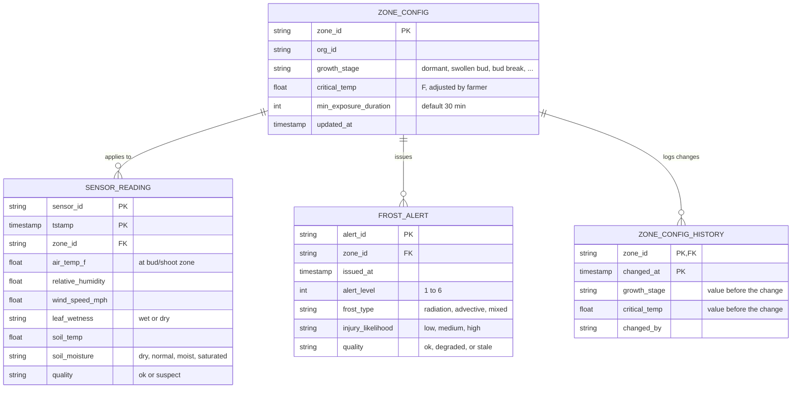
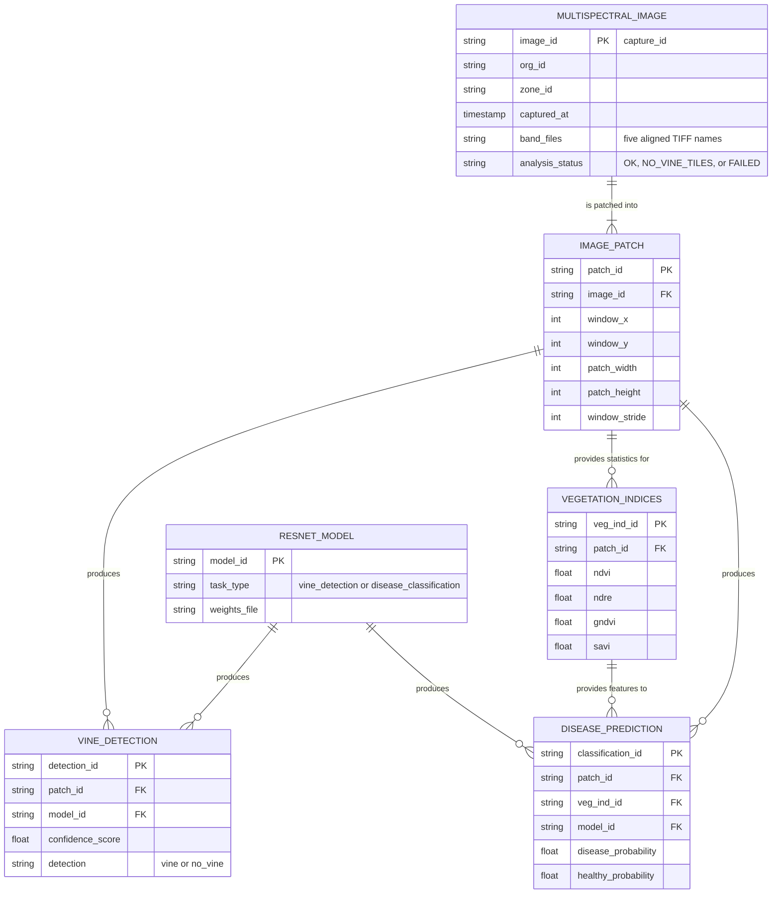
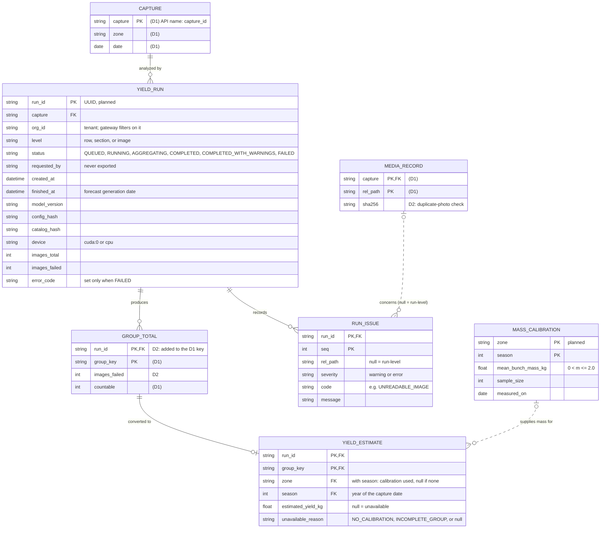
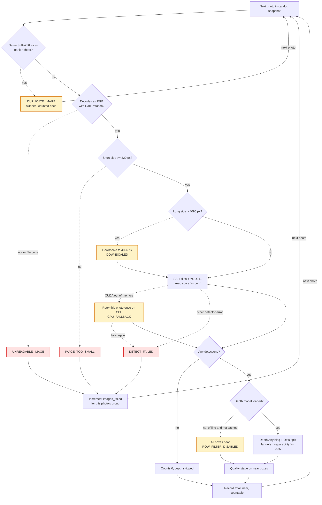

# Header, conventions, and D2 overview

**Project Title:** OMID AI-Based Farm Disease, Pest, Yield, and Frost Detection System

**Team Members:** Andrea Dall'Ara, Bridget Trout, Dang Luu, Cyrus Speicher

**Goal Statement:** Help crop farmers make timely, informed decisions by combining stationary sensor readings and drone imagery to assess frost, disease, and pest risks, estimate crop yield, and provide organized records for planning and research.

## Diagram conventions

The project title and goal statement are repeated above every figure. Figure IDs: F = frost, D = disease, Y = yield.

| Diagram type | Element | Meaning |
|---|---|---|
| ER (F-1, D-1, Y-1) | Box | One entity. Title is the entity name; each line is one key attribute. |
| ER | `PK`, `FK` | Primary key, foreign key. Two `PK` marks in one box form a composite key. |
| ER | Solid / dashed line | Identifying relationship (child cannot exist without parent) / non-identifying relationship. |
| ER | Crow's foot | Cardinality: `\|\|` exactly one, `o\|` zero or one, `\|{` one or more, `o{` zero or more. |
| ER | "planned" | Designed but not yet in code. |
| State machine (F-2) | Black circle | Initial state. |
| State machine | Gray rounded box | A normal state (an alert level). |
| State machine | Red box | Error, degraded, or failed state. |
| State machine (F-2) | Blue box | "Return to held level": the engine goes back to the level it held before the error. |
| State machine | Solid / dashed arrow | Normal transition / error path. Arrow text is the condition. |
| Flowchart (Y-2) | Rectangle / diamond | A processing step / a decision (arrows are labeled with the answer). |
| Flowchart | Solid / dashed arrow | Normal path / error or fallback path. |
| Flowchart | Amber box | Degraded or skipped: a warning `RUN_ISSUE` is logged. |
| Flowchart | Red box | Failed: the photo is left out of the count and an error `RUN_ISSUE` is logged. |

## Two-minute overview

OMID is an open, generative-AI-powered precision agriculture platform for smallholder vineyards. Stationary IoT sensor boxes (I2) and low-altitude drone imagery (I1) enter through one Web App & API Gateway, which authenticates users and calls four modules: frost prediction (I3), disease detection (I4), pest detection (I5), and yield estimation (I6). **D0** gave the block diagram, interfaces I1–I6, and decisions DL-1 to DL-6. **D1** detailed the disease, pest, web-app data access, and yield algorithms and data model, and deferred frost. **D2** finishes every component with a data model, behavior, interface, edge cases, and error handling. It adds the glue components (authentication, notifications, configuration, logging), a traceability table, a rationale, and the peer review notes.

## Known gaps and open questions

- **Mobile offline:** the dashboard cannot show cached maps without a connection.
- **Sensor battery:** HTTP/REST (I2) drain is unmeasured; if field tests fail, MQTT is required (D0 DL-5).
- **Tenant isolation:** `org_id` is now stored on captures and yield runs and filtered by the gateway (§2.4). BigQuery partition validation across farms is still open.
- **Frost thresholds:** the Level 2 and Level 3 conditions in §2.1 were formalized in D2 using the projected temperature and should be confirmed with an agronomist.
- **Yield:** converting counts to kg needs `MASS_CALIBRATION` (who weighs bunches, how many, and when is an open question for OMID). Bunches in overlapping photos are counted twice (EC-Y16). Counts and run times are estimates, not measurements; we propose AC-02.3 and NFR-PERF (§4).
- **Open question (web app):** where are crop type and harvest period stored for the buyer export (AC-04.1)?

---

# Finished components, the D2 diagrams

## 2.1 Frost Prediction Engine (I3)

### Data model

> **OMID AI-Based Farm Disease, Pest, Yield, and Frost Detection System**
> *Goal: Help crop farmers make timely, informed decisions by combining stationary sensor readings and drone imagery to assess frost, disease, and pest risks, estimate crop yield, and provide organized records for planning and research.*
> **Figure F-1: Frost data model** (ER conventions above)



An alert is derived from several readings, so it holds a `zone_id` and no key to a single reading. The forecast is fetched when the engine runs and is not stored. Readings and thresholds are stored in °F. Ingestion converts the sensors' °C (D0 I2) on write, and the dew-point step converts to °C internally and back.

### Behavior

Every 15 minutes, per zone, the engine computes:

$$CoolingRate_{60} = T_{now} - T_{60min} \qquad T_{projected,2h} = T_{now} + 2(CoolingRate_{60})$$

$$\gamma = \ln\left(\frac{RH}{100}\right) + \frac{aT}{b+T},\quad T_d = \frac{b\gamma}{a-\gamma},\quad DewPointSpread = T_{air} - T_d \qquad (a = 17.625,\ b = 243.04\,°C)$$

Alert levels are evaluated top-down each cycle, so an alert may skip levels. Level 5 is left only through Level 6, which prevents a false all-clear.

| Level | Name | Enter when |
|---|---|---|
| 1 | Normal | No higher condition holds. |
| 2 | Frost Watch | Growth stage is swollen bud or later (sensitive tissue) and $T_{projected,2h} \le$ `critical_temp` + 2°F (rapid cooling). |
| 3 | Frost Warning | Growth stage is swollen bud or later and $T_{projected,2h} \le$ `critical_temp`. Wind > 10 mph classifies the event as advective; otherwise radiation. |
| 4 | Frost Imminent | Air ≤ 33°F or bud-zone temperature ≤ 32°F. |
| 5 | Event In Progress | Temperature ≤ `critical_temp` for at least `min_exposure_duration`. |
| 6 | All Clear | From Level 5 only: temperature ≥ `critical_temp` + 2°F, stable or rising for 30 min, and no forecasted decline. If no forecast is available, only the first two conditions are used. Level 6 is a recovery state, not the most severe level. |

> **OMID AI-Based Farm Disease, Pest, Yield, and Frost Detection System**
> *Goal: Help crop farmers make timely, informed decisions by combining stationary sensor readings and drone imagery to assess frost, disease, and pest risks, estimate crop yield, and provide organized records for planning and research.*
> **Figure F-2: Frost alert state machine, including error paths** (state-machine conventions above)

```mermaid
flowchart TB
    classDef state fill:#f3f4f6,stroke:#374151,stroke-width:2px
    classDef errorState fill:#fee2e2,stroke:#dc2626,stroke-width:2px
    classDef resume fill:#dbeafe,stroke:#2563eb,stroke-width:2px
    classDef point fill:#000,stroke:#000

    Start((( ))):::point
    L1["Level 1: Normal"]:::state
    L2["Level 2: Frost Watch"]:::state
    L3["Level 3: Frost Warning"]:::state
    L4["Level 4: Frost Imminent"]:::state
    L5["Level 5: Event In Progress"]:::state
    L6["Level 6: All Clear"]:::state
    ErrData["Invalid Data Handler<br>(reading rejected, quality flag set)"]:::errorState
    ErrSensor["Degraded Alert State<br>(Sensor unavailable or data stale)"]:::errorState
    Resume["Return to held level<br>(level before the error)"]:::resume

    Start --> L1
    L1 -->|Sensitive stage & rapid cooling| L2
    L2 -->|Warning thresholds met| L3
    L1 -->|Sensitive stage & projected temp ≤ critical| L3
    L3 -->|Air ≤ 33°F or bud ≤ 32°F| L4
    L4 -->|Temp ≤ critical for min exposure| L5
    L5 -->|Temp ≥ critical+2°F, stable 30 min, no forecast decline| L6
    L6 -->|All clear issued| L1
    L6 -->|Temp ≤ critical again| L5
    L2 -->|Watch conditions clear| L1
    L3 -->|Warning conditions clear| L2
    L4 -->|Imminent conditions clear for 2 readings| L3

    L1 & L2 & L3 & L4 & L5 -.->|Range error or spread < -0.2°F| ErrData
    L1 & L2 & L3 & L4 & L5 -.->|Stale: 2 missed intervals in L1, 1 in L2-L5| ErrSensor
    ErrData -.->|Next valid reading| Resume
    ErrSensor -.->|Fresh valid reading| Resume
```



While in either red state the engine never lowers the alert and displays "Sensor data unavailable" with the time of the last good reading (EC-F1).

### Interface (I3, revised)

**Endpoint:** internal method call, `evaluate(zone_id, readings, zone_config, forecast?)`. The gateway loads the history, so the engine never queries a database.<br>
**Input:** JSON object with `zone_id`, `readings` (15-minute readings from the last 6 hours, at least 2), `zone_config` thresholds, and an optional latest `forecast`.<br>
**Output:** JSON object `{zone_id, alert_level, level_name, frost_type, injury_likelihood, quality: "ok" | "degraded" | "stale", last_reading_at}`.<br>
**Errors:** `INSUFFICIENT_DATA` (fewer than two valid readings; the gateway keeps the last alert), `INVALID_CONFIG`. Errors use `{success:false, code, error}`.

## 2.2 Disease Detection (I4)

### Data model

> **OMID AI-Based Farm Disease, Pest, Yield, and Frost Detection System**
> *Goal: Help crop farmers make timely, informed decisions by combining stationary sensor readings and drone imagery to assess frost, disease, and pest risks, estimate crop yield, and provide organized records for planning and research.*
> **Figure D-1: Multispectral disease data model** (ER conventions above)



The single-photo ViT workflow (`/predict`, D1 algorithm 1) has **no persistent data**: the result is returned and held only in the app. In multispectral captures, a vine detection gates which patches reach the disease model.

### Behavior

**Single photo (`/predict`).** Decode, preprocess, run the ViT, apply softmax. If the top-class probability is below `low_confidence_cutoff` (default 0.5, set on validation data), return `status: "MANUAL_REVIEW"` with the top three classes. Otherwise return `status: "OK"`.

**Multispectral (`/process-capture`).** Validate at least five TIFFs and a unique `capture_id`; align the bands, compute NDVI and NDRE, and tile (D1 algorithm 2); skip tiles with vine probability below 0.5 and run the disease model on the rest. If no tile qualifies, set `status: "NO_VINE_TILES"` instead of reporting a healthy crop. Upload outputs, write Firestore (with `org_id` and `zone_id`), and return URLs only.

### Interface (I4, revised)

| Route | Input | Success | Errors |
|---|---|---|---|
| `POST /predict` | Multipart `file` | `200 {disease, confidence, top3, status}` | `400 INVALID_IMAGE`; `503 MODEL_UNAVAILABLE` |
| `POST /process-capture` | Multipart `files` (TIFF), `capture_id`, `zone_id`; `org_id` from `X-Request-User` | `200 CaptureResponse` | `400 TOO_FEW_BANDS`; `409 CAPTURE_EXISTS`; `413 FILE_TOO_LARGE`; `422 ALIGNMENT_FAILED`; `502 UPLOAD_FAILED`; `503 MODEL_UNAVAILABLE` |

`CaptureResponse = {capture_id, status, inference_summary, firebase_upload}`. The D1 server-local directory paths are removed, and the summary's `output_files` become public URLs. `inference_summary.status` is `OK`, `NO_VINE_TILES`, or `MANUAL_REVIEW`. Error body: `{success:false, code, error}`.

## 2.3 Pest Detection (I5)

**Data model:** no persistent data. Each request is stateless, and results stay in the app.<br>
**Behavior:** validate (decodes, at least 64×64 px), normalize, run ResNet-18 on CPU, apply softmax over six classes. If the top confidence is below 0.5, return `status: "UNCERTAIN"`.<br>
**Interface (I5, revised):** `POST /pests_predict` with multipart `file` returns `200 {success:true, prediction, confidence, status: "OK" | "UNCERTAIN"}`. Errors: `400 INVALID_IMAGE`, `422 IMAGE_TOO_SMALL`, `503 MODEL_UNAVAILABLE`, with body `{success:false, code, error}`. D0 listed a bounding box in I5's output, but the D1 model is a classifier, so the box is removed.

## 2.4 Web App & Gateway: ingestion (I1, I2) and history

**Data model.**
- `SENSOR_READING` (BigQuery): fields as in Figure F-1, plus `org_id`, `site_id`, `battery_level`. Key: `(sensor_id, tstamp)`.
- `SENSOR_STATUS` (Firestore `sensors/{sensor_id}`): `zone_id`, `last_seen`, `state` (ACTIVE or STALE), `key_hash`.
- `CAPTURE` (Firestore `captures/{capture_id}`): D1 fields plus `org_id` and `zone_id`. The dashboard stream now filters by `org_id`.

**Behavior (I2).** Check the sensor key, validate the schema and ranges, convert units to °F, upsert by `(sensor_id, tstamp)`, update `last_seen`, acknowledge. A monitor marks a sensor STALE when `last_seen` exceeds the freshness limit, and the dashboard then lists it and refuses a "current" prediction (AC-01.2).<br>
**Behavior (I1).** Authenticate, accept only supported formats, store the capture with `org_id` and `zone_id`, route it to I4 (TIFF) or I6 (JPEG or PNG), return `capture_id`.<br>
**History (D1, unchanged):** D2 adds validation of start before end, site/zone parentage, and a point limit (EC-W4).

| Interface | Route | Success | Errors |
|---|---|---|---|
| I1 | `POST /api/v1/captures` (multipart `files`, `zone_id`) | `201 {capture_id}` | `401`; `413 FILE_TOO_LARGE`; `415 UNSUPPORTED_FORMAT` |
| I2 | `POST /api/v1/readings` (JSON as in D0, plus `sensor_id`; header `X-Sensor-Key`) | `200 {ack:true, duplicate:boolean}` | `400 SCHEMA_INVALID`; `401`; `422 OUT_OF_RANGE`; `503 STORE_UNAVAILABLE` |

## 2.5 Yield Estimation (I6)

The module runs today as the batch script `scripts/run_pipeline.py`. Items marked "planned" are designed but not yet built.

### Data model

> **OMID AI-Based Farm Disease, Pest, Yield, and Frost Detection System**
> *Goal: Help crop farmers make timely, informed decisions by combining stationary sensor readings and drone imagery to assess frost, disease, and pest risks, estimate crop yield, and provide organized records for planning and research.*
> **Figure Y-1: Yield data model.** Entities marked "(D1)" show only the attributes needed here; D1 has the full lists. (ER conventions above)



`GROUP_TOTAL` is keyed by `(run_id, group_key)`, which supersedes the D1 key so that a re-run after retraining does not overwrite an earlier count (AC-05.1 exports need both). `RUN_ISSUE` is a separate log because failures are per photo. Bunch mass moves from configuration into `MASS_CALIBRATION` because mass differs by block and year. Storage stays as flat files per run, as in D1; the web app copies the finished summary to Firestore `yield_runs/{run_id}`.

### Behavior: run lifecycle

A run's `status` moves `QUEUED`, `RUNNING`, `AGGREGATING`, then `COMPLETED` (no issues) or `COMPLETED_WITH_WARNINGS` (at least one issue). It ends in `FAILED` if no photo was readable, outputs cannot be written, or the service restarts mid-run. Cheap checks (capture exists, name has a zone and date, at least one supported photo, model loaded) run before a run is created and fail at once without creating one. One GPU worker takes runs first-in, first-out. On startup, any run left in `RUNNING` becomes `FAILED` with `INTERRUPTED`.

### Behavior: per-photo processing with error paths

> **OMID AI-Based Farm Disease, Pest, Yield, and Frost Detection System**
> *Goal: Help crop farmers make timely, informed decisions by combining stationary sensor readings and drone imagery to assess frost, disease, and pest risks, estimate crop yield, and provide organized records for planning and research.*
> **Figure Y-2: Per-photo flow with error paths** (flowchart conventions above)



After all photos are attempted, `aggregate` sums each group and the yield step runs:

```text
If the group has images_failed > 0:  estimated_yield_kg = null, reason INCOMPLETE_GROUP (count still shown, flagged)
Else if no MASS_CALIBRATION for (zone, season):  null, reason NO_CALIBRATION
Else:  estimated_yield_kg = countable x mean_bunch_mass_kg   (0 countable gives 0 kg, a real zero)
```

### Interface (I6, revised)

| D0 I6 | D2 I6 | Why |
|---|---|---|
| Request carries the field images. | Request carries a `capture_id`; photos are uploaded once through I1. | Avoids re-uploading 22 to 2,200 photos per run over a weak connection. |
| Detector settings unstated. | No model settings in the request; `conf`, tile size, device are server configuration recorded in `config_hash`. | Client-set values would make counts incomparable and leak internals. |
| One synchronous response. | `202 Accepted` with a `run_id`, then polling. | A 2,200-photo run takes up to about 55 min on a GPU, far beyond an HTTP timeout. |
| One "imagery too poor" failure. | Per-photo `Issue` records plus run-level error codes. | One bad photo must not fail the run, and the worker needs to know which files to retake (AC-02.2). |

**Authentication.** I6 is internal. The gateway checks the user's role on every request and calls I6 with `X-Internal-Service-Key` and `X-Request-User`, as in §2.6. The yield service stores no roles, so a revoked permission takes effect on the next call (AC-03.2). Every route also checks that the run's `org_id` matches the caller's organization.

| Method / route | Input | Success | Errors |
|---|---|---|---|
| `POST /yield/runs` | `RunRequest` | `202 RunStatus` (new run); `200 RunStatus` if a matching run exists and `force` is false (EC-Y17) | `400 INVALID_LEVEL`; `401`; `404 CAPTURE_NOT_FOUND`; `422 CAPTURE_NAME_INVALID`; `422 NO_SUPPORTED_IMAGES`; `503 MODEL_UNAVAILABLE` |
| `GET /yield/runs/{run_id}` | path | `200 RunStatus` | `401`; `404 RUN_NOT_FOUND` |
| `GET /yield/runs/{run_id}/results` | path | `200 RunResult` (completed runs only) | `401`; `404`; `409 RUN_NOT_FINISHED`; `409 RUN_FAILED` |
| `PUT /yield/calibrations/{zone}/{season}` | `Calibration` | `200 Calibration` | `400 INVALID_MASS`; `401` |

**Types.** `RunRequest = {capture_id, level?: "row"|"section"|"image" (default "row"), force?: boolean (default false)}`. `RunStatus = {run_id, capture_id, status, images_total, images_failed, model_version, error_code}`. `RunResult = {run, zone, capture_date, groups, issues, limitations}`, where `limitations` always includes `OVERLAP_NOT_CHECKED` (EC-Y16). `GroupResult = {group_key, images, images_failed, total, near, countable, estimated_yield_kg: number|null, unavailable_reason: "NO_CALIBRATION"|"INCOMPLETE_GROUP"|null}`. `Issue = {rel_path|null, severity, code, message}`. `Calibration = {mean_bunch_mass_kg, sample_size, measured_on}`. Error body: `{success:false, code, error}`. Responses never contain server-local paths.

## 2.6 Glue components

### Authentication and access control

**Data model:** no local data. Firebase Authentication issues the token; Firestore `organizations/{orgId}/members/{userId}` holds `role` and the flags `canManageMembers`, `canManageSites`, `canManageSensors`. Sensor boxes use a per-sensor key (hash in `SENSOR_STATUS`).<br>
**Behavior:** on every request the gateway verifies the `Authorization: Bearer` token (`verifyAuthHeader`), loads the membership and permission flags (`isOrgMember`), and forwards to a module with `X-Internal-Service-Key` and `X-Request-User`. Nothing is cached, so a revoked permission gives `403` on the next call (AC-03.2). Role changes run in a transaction (`RoleUpdater`). Authentication fails closed.<br>
**Interface:** `POST /api/v1/auth/verify` returns `200 {valid, uid, orgId, permissions}`. Errors: `401 UNAUTHORIZED`, `403 FORBIDDEN`, `503 AUTH_UNAVAILABLE`.

### Notifications

**Data model:** `NOTIFICATION_EVENT {event_id PK, org_id, zone_id, alert_type: FROST|DISEASE|PEST|SENSOR_OFFLINE|SYSTEM, severity: INFO|WARNING|CRITICAL, message, created_at, dedup_key, status: PENDING|SENT|FAILED}`.<br>
**Behavior:** the gateway creates an event when an I3, I4, or I5 result crosses a threshold (frost Level 3 or higher) or a sensor goes STALE. It validates the event and suppresses repeats of the same `dedup_key` (zone, type, level) unless the level rose. `CRITICAL` events (frost Level 4 or higher) are sent at once; `INFO` and `WARNING` events are merged into one digest per user per 15 minutes. Events go to the in-app feed, which the dashboard streams like `captures`.<br>
**Interface:** internal `notify(event) -> {status, suppressed}`. Errors: `INVALID_EVENT`, `STORE_UNAVAILABLE`.

### Configuration

**Data model:** farmer-set zone thresholds are `ZONE_CONFIG` and `ZONE_CONFIG_HISTORY` (Figure F-1). Service settings are layered (defaults, project YAML, overrides) and checked at startup.<br>
**Behavior:** `PUT /api/v1/zones/{zone_id}/config` needs `canManageSites`, validates the growth stage and numeric ranges, appends the old values to the history, and writes only if the caller's `updated_at` matches the stored value.<br>
**Interface:** body `{growth_stage, critical_temp, min_exposure_duration, updated_at}` returns `200 ZoneConfig`. Errors: `400 INVALID_CONFIG`, `403`, `404 ZONE_NOT_FOUND`, `409 CONFIG_CONFLICT`.

### Logging

**Data model:** no database; each service writes one JSON line `{ts, level, service, request_id, user_id, event, code?, message}`.<br>
**Behavior:** the gateway creates `request_id` and passes it as `X-Request-Id`, so one request can be followed across services. Logging never raises or blocks a request.<br>
**Interface:** `log(level, event, **fields) -> None`.

## 2.7 D0 interface revisions

| ID | D0 problem | D2 change |
|---|---|---|
| I1 | Format only. | `POST /api/v1/captures` with `zone_id`; returns `capture_id`; `413`/`415` errors (§2.4). |
| I2 | No sensor identity, duplicate handling, or unit rule. | Adds `sensor_id`, `X-Sensor-Key`, an idempotent `duplicate` flag, and °C→°F on ingestion (§2.4). |
| I3 | Array output; "database unreachable" error although history is an input. | Object in and out with a `quality` field; engine never queries a database (§2.1). |
| I4 | Returned server-local paths. | URLs only, plus `status` and specific error codes (§2.2). |
| I5 | Promised a bounding box the classifier cannot give. | Classification only, plus `status` and error codes (§2.3). |
| I6 | Too many parameters; synchronous. | `capture_id`, `202` and polling, server-side settings (§2.5). |

---

# Edge cases and error handling

Every row has a decided behavior, a named handler, and a recoverability note. Error paths are drawn in Figures F-2 and Y-2.

| ID | Component | Category | Edge case | Design decision | Handler | Recoverable |
|---|---|---|---|---|---|---|
| EC-F1 | Frost | Missing input | Primary temperature sensor fails during an active warning | Hold the alert, show "Sensor data unavailable" and the last reading time (F-2) | `AlertDowngradeGuard` | Yes |
| EC-F2 | Frost | Timing | Reporting intervals missed | Stale after 2 missed (L1) or 1 (L2+); never downgrade on stale data | `StaleDataMonitor` | Yes |
| EC-F3 | Frost | Bad input | Humidity or temperature outside its valid range | Reject the reading, skip dew point and spread, set the quality flag, evaluate temperature-only rules | `DewPointCalculator` | Yes |
| EC-F4 | Frost | Boundary | Dew-point spread below −0.2°F | Treat as a sensor or unit mismatch; flag quality, ignore the spread | `SpreadValidator` | Yes |
| EC-F5 | Frost | Boundary | Soil saturated | Does not lower the level; shown as context only | `RiskModifier` | Yes |
| EC-F6 | Frost | External | History store unreachable | Gateway retries 3 times, then holds the last alert marked "Data delayed" | `HistoryLoader` | Yes |
| EC-F8 | Frost | Concurrency | Duplicate or late reading | Upsert by `(sensor_id, tstamp)`; a late reading is stored and used next cycle; cycles run serially per zone | `ReadingStore`, `CycleScheduler` | Yes |
| EC-D1 | Disease | Boundary | Top-class probability below the cutoff, or no vine tile | `MANUAL_REVIEW` or `NO_VINE_TILES`; never reported as healthy | `ResultClassifier` | Yes, retake |
| EC-D2 | Disease | Bad input | Corrupt image, or fewer than five TIFFs | `400 INVALID_IMAGE` or `TOO_FEW_BANDS`; nothing stored | `CaptureValidator` | Yes |
| EC-D4 | Disease | Concurrency | Same `capture_id` uploaded twice | `409 CAPTURE_EXISTS`; no overwrite | `CaptureValidator` | Yes |
| EC-D5 | Disease | External | Firebase upload or write fails | `502 UPLOAD_FAILED`; keep local outputs, skip cleanup, client may retry | `FirebaseUploader` | Yes |
| EC-P1 | Pest | Boundary | Image under 64×64 px or confidence below 0.5 | `422 IMAGE_TOO_SMALL`, or `status: UNCERTAIN` | `PestValidator` | Yes, retake |
| EC-P2 | Pest | Bad input | Undecodable file | `400 INVALID_IMAGE` instead of a generic 500 | `PestValidator` | Yes |
| EC-P3 | Pest | Concurrency | Simultaneous requests | Stateless CPU inference; requests are independent | `predict` | Not an error |
| EC-P4 | Pest | External | Weights missing or corrupt | `503 MODEL_UNAVAILABLE` | `ModelLoader` | Yes |
| EC-W1 | Web app (I1, I2) | Bad input | Unsupported file (I1) or invalid reading (I2) | `415`, `400 SCHEMA_INVALID`, or `422 OUT_OF_RANGE`; nothing stored; sensor flagged | `UploadRouter`, `ReadingValidator` | Yes |
| EC-W2 | Web app | Timing | Sensor stops reporting | Mark STALE; the dashboard lists it and refuses a current prediction (AC-01.2) | `SensorHealthMonitor` | Yes |
| EC-W3 | Web app | Concurrency | Sensor retries the same POST | Idempotent upsert; `200` with `duplicate: true` | `ReadingStore` | Yes |
| EC-W4 | Web app (history) | Boundary | Start after end, zone outside site, or too many points | `400 RANGE_INVALID`, `403 ZONE_NOT_IN_SITE`, `413 TOO_MANY_POINTS` (suggest a coarser interval) | `HistoryValidator` | Yes |
| EC-W5 | Web app | External | BigQuery or Firestore unavailable | `503 STORE_UNAVAILABLE`; sensor boxes buffer and retry with backoff | `ReadingStore` | Yes |
| EC-A1 | Auth | Boundary | Token expires mid-request | Treated as expired: `401`; the client refreshes and retries once | `verifyAuthHeader` | Yes |
| EC-A2 | Auth | Bad input | Missing or malformed header | `401 UNAUTHORIZED` | `verifyAuthHeader` | Yes |
| EC-A3 | Auth | Concurrency | Permission revoked during an active session, or two owners demote each other | Re-read membership each request (`403`); role changes run in a transaction | `isOrgMember`, `RoleUpdater` | Yes |
| EC-A4 | Auth | External | Firebase unreachable | Fail closed: `503 AUTH_UNAVAILABLE` | `verifyAuthHeader` | Yes |
| EC-N1 | Notifications | Boundary | Burst of events in one window | Batch INFO/WARNING per user per 15 min; CRITICAL sent at once | `NotificationBatcher` | Yes |
| EC-N2 | Notifications | Bad input | Event missing zone or type, or unknown severity | `INVALID_EVENT`; not sent; logged | `NotificationValidator` | Yes |
| EC-N3 | Notifications | Timing | Same alert re-evaluated every 15 min | Suppress repeats of the same `dedup_key` unless the level rose | `DedupFilter` | Yes |
| EC-N4 | Notifications | External | Feed write fails | Retry 3 times, then mark `FAILED` and log; the alert still shows on the dashboard | `NotificationDispatcher` | Yes |
| EC-C1 | Configuration | Boundary | `critical_temp` or `min_exposure_duration` out of range | `400 INVALID_CONFIG`; keep the old config | `ZoneConfigValidator` | Yes |
| EC-C2 | Configuration | Bad input | Unknown `growth_stage` or zone | `400 INVALID_CONFIG` or `404`; no write | `ZoneConfigValidator` | Yes |
| EC-C3 | Configuration | Concurrency | Two admins edit one zone | Stale `updated_at` returns `409 CONFIG_CONFLICT`; history keeps both | `ZoneConfigStore` | Yes |
| EC-C4 | Configuration | External | Config store unreachable during an engine cycle | Use the cached config and mark quality `degraded` | `ZoneConfigStore` | Yes |
| EC-L1 | Logging | Boundary | Oversized message | Truncate and set `truncated: true` | `Logger` | Yes |
| EC-L2 | Logging | Bad input | Missing `request_id` or fields | Generate or fill them; never reject | `Logger` | Yes |
| EC-L3 | Logging | Concurrency | Many concurrent writers | One JSON object per line, atomic append | `Logger` | Yes |
| EC-L4 | Logging | External | Disk full or sink unavailable | Drop INFO and DEBUG, keep ERROR on stderr; never fail the request | `LogSinkFallback` | Yes |
| EC-Y1 | Yield | Boundary | Capture has no JPEG or PNG | `422 NO_SUPPORTED_IMAGES` listing accepted formats; no run created (AC-02.2) | `RunQueue.submit` | Yes, resubmit |
| EC-Y5 | Yield | Boundary | Photo with a long side over 4096 px | Degrade: downscale and log `DOWNSCALED` (Y-2) | `PhotoWorker` | Yes |
| EC-Y7 | Yield | Boundary | Mass missing, or ≤ 0 or > 2.0 kg | Out of range: `400 INVALID_MASS`. Missing: yield null with `NO_CALIBRATION`, never 0 (AC-04.2) | `CalibrationStore`, `estimate_yield` | Yes, add a calibration and re-run with `force` |
| EC-Y9 | Yield | Bad input | Corrupt photo, or file deleted after the snapshot | Log `UNREADABLE_IMAGE` and continue; group yield null `INCOMPLETE_GROUP` (Y-2); closes the D1 open item | `PhotoWorker` | Yes, retake and re-run |
| EC-Y11 | Yield | Bad input | Folder name has no valid zone or date | `422 CAPTURE_NAME_INVALID` (AC-02.1 needs both) | `RunQueue.submit` | Yes, rename |
| EC-Y16 | Yield | Bad input | Consecutive shots overlap, so a bunch is counted twice | Not detected. Every `RunResult` carries `OVERLAP_NOT_CHECKED`, and the capture protocol requires non-overlapping shots | `aggregate` | No, until tracking exists |
| EC-Y17 | Yield | Concurrency | Same request sent twice | Return the existing run (`200`) unless `force` is true; the key is capture, level, `catalog_hash`, `config_hash`, `model_version` | `RunQueue.submit` | Yes |
| EC-Y20 | Yield | Concurrency | Service restarts during a run | At startup mark `RUNNING` runs `FAILED` with `INTERRUPTED`; no auto-retry | `StartupRecovery` | Yes, resubmit |
| EC-Y25 | Yield | External | GPU out of memory on a photo | Retry that photo once on CPU (`GPU_FALLBACK`); a second failure logs `DETECT_FAILED` (Y-2) | `PhotoWorker` | Yes |
| EC-Y26 | Yield | External | Depth weights not cached and offline | Row filter off, all boxes near, `ROW_FILTER_DISABLED` warning (Y-2) | `build_pipeline` | Yes, cache weights and re-run |
| EC-Y27 | Yield | External | Detector weights missing or corrupt | Service not ready; `503 MODEL_UNAVAILABLE`; no fallback to a generic model | `build_pipeline` | Yes |
| EC-Y29 | Yield | External | Web app cannot reach I6 or its Firestore write fails | Results stay in the run store; the app retries the idempotent `GET` with backoff and shows "result pending" | `YieldRunPoller` (owner: Andrea) | Yes |

---

# Requirements traceability table

Requirement IDs are the acceptance criteria in User_Stories. `R-F` rows are frost requirements derived from AC-01.1 and the D0 responsibility table. `NFR-` rows come from the constraints essay. Rows marked "proposed" are not yet in User_Stories.

| ID | Short text | Priority | Design elements | How it is satisfied | Gap explanation |
|---|---|---|---|---|---|
| AC-01.1 | Show predicted likelihood, period, field, and sensor timestamp | High | I3 output, `FROST_ALERT`, I4/I5 `status`, F-2, §2.4 `SENSOR_READING` | Each result carries its zone and the time of the last reading. Disease and pest results return class, confidence, and a status flag (§2.2, §2.3). | Disease and pest models predict from images, not from a forecast period. Only frost gives a time period (the 2 h projection). |
| AC-01.2 | Name stale sensors and refuse a current prediction | High | `SENSOR_STATUS.state`, `StaleDataMonitor`, EC-F2, EC-W2, F-2 | A STALE sensor is listed and the alert is shown as degraded, never as current. | None |
| R-F1 | Distinguish frost mechanisms | High | `frost_type`, rule table L3 | Wind > 10 mph classifies advective; otherwise radiation. | "Mixed" has no rule yet; the domain owner should define it. |
| R-F2 | Calculate dew point accurately | High | Magnus formula, `DewPointCalculator`, EC-F3, EC-F4 | °F inputs converted to °C internally; invalid inputs rejected. | None |
| R-F3 | Prevent false all-clears | High | F-2 Level 5→6, rule table L6, EC-F1 | The only exit from Level 5; needs +2°F, 30 min stable, no forecast decline. | None |
| R-F4 | Use bud-zone temperature | Med | `SENSOR_READING.air_temp_f` | Rules read the bud/shoot-zone reading. | None |
| R-F5 | Retain configuration history | Med | `ZONE_CONFIG_HISTORY`, EC-C3 | Every change appends the old values. | Outcome of each alert is not linked to a config version. |
| AC-02.1 | Show a whole-number count and yield with unit, field, and date | High | `POST /yield/runs`, `GroupResult`, `RunResult.zone`, `capture_date`, Y-2, EC-Y11 | One request starts the count. Zone and date come from the capture name. | Yield in kg needs `MASS_CALIBRATION`. "Countable" uses the size baseline until the fullness CNN exists. Accuracy is unmeasured. |
| AC-02.2 | Explain why analysis cannot proceed; show no count | High | `422 NO_SUPPORTED_IMAGES`, `FAILED` state, `Issue`, EC-Y1, EC-Y9 | Refused before a run exists, or the run ends `FAILED` and `/results` returns `409 RUN_FAILED`. | None |
| AC-02.3 (proposed) | Count only near-row, full bunches | High | Row filter, quality stage, D1 algorithm 5, DR-05, DR-07 | Detection, then Otsu depth split, then quality stage. | Not yet in User_Stories; proposed so this logic is not scope creep. |
| AC-03.1 | Role-based login and access | High | §2.6 auth, `verifyAuthHeader`, `isOrgMember`, EC-A1, EC-A2, EC-A4 | Every request checks the token and membership; modules accept only gateway calls. | Service-key rotation is not designed (owner: Andrea). |
| AC-03.2 | A revoked permission is denied on the next request | High | Per-request permission read, `RoleUpdater` transaction, EC-A3 | Nothing is cached across requests. | None |
| AC-04.1 | Buyer export with crop, field, harvest period, yield, date | Med | `YIELD_RUN.finished_at`, `GroupResult.estimated_yield_kg`, `RunResult.zone` | The yield module supplies yield, unit, field, and generation date. | Crop type and harvest period are not stored by the yield module (open question for the web app). Export format is outside this module. |
| AC-04.2 | Label missing yield as unavailable, not 0 | High | `estimated_yield_kg = null`, `unavailable_reason`, EC-Y7, EC-Y9 | Null plus a reason; a real zero stays 0 kg. | None in the module; the export label belongs to the web app. |
| AC-05.1 | Research CSV with anonymized fields, no account IDs | Med | `GROUP_TOTAL` keyed by run, `per_<level>.csv`, `YIELD_RUN.requested_by` excluded | Every run is kept; `requested_by` is excluded. | Yield and frost records are covered. Disease and pest results are not stored beyond `captures`, so their export depends on the web app. Anonymization is applied by the web-app export. |
| AC-05.2 | "No records found" message and no file for an empty range | Med | History query returns `graphs: []` | The web app shows the message when the query is empty. | The message and UI are web-app work, not yet designed here. |
| NFR-SEC | Access control, logging, retained versions, data-quality flags | High | §2.6 auth and logging, `YIELD_RUN` hashes, `RUN_ISSUE`, `quality` fields, `X-Request-Id` | Every count and alert traces to its inputs and versions. | None |
| NFR-ECON | Stay within the $2,000 budget (D0 DL-6) | High | Reused hardware, CPU fallback (EC-Y25), free libraries | All dependencies are free; yield runs on CPU or an owned GPU. | Ultralytics is AGPL-3.0; an RT-DETR fallback exists. |
| NFR-ENV | Work with an unreliable vineyard connection | Med | Sensor retry and buffering (EC-W5), `capture_id` instead of re-upload, EC-Y26 | Offline degradation with warnings instead of failure. | Mobile offline viewing is unaddressed; MQTT is untested (DL-5). |
| NFR-SOC | Adaptable to new regions and crops | Low | `ZONE_CONFIG`, `MASS_CALIBRATION` per zone and season, detector interface | A new block or season needs only configuration rows. | A new crop needs new labeled photos; there is no zero-shot path. |
| NFR-PERF (proposed) | Capture results within about 1 hour of upload | Med | Async runs (§2.5), EC-Y25 | Batch job on GPU; 202 and polling. | No requirement states a limit; we propose one and will measure before optimizing. |

**Reverse check: design elements with no direct requirement.**

| Design element | Decision |
|---|---|
| Frost `min_exposure_duration` and `T_projected` | Now used in Levels 2, 3, and 5 and traced to R-F3 and R-F1. Keep. |
| Yield threshold tuning (D1 algorithm 6) | Keep; it makes AC-02.1 counts trustworthy. Proposed NFR: count error target on the test split. |
| `DETECTION.features`; learned row filter | Keep `features` (cheap). The learned filter is deferred until row labels exist. |

---

# Design rationale

These entries expand the significant D1 and D2 decisions. The architecture baseline remains in D0's **Decision log (DL-1 through DL-6)** and is referenced rather than repeated here. Entries updated by the peer review are marked **Updated by peer review**.

## DR-01: Separate single-photo and multispectral disease workflows

We chose separate single-photo ViT and multispectral disease workflows over one shared inference pipeline because the photo model uses a 224×224 preprocessed image, while the multispectral model requires aligned bands, spectral indices, and seven-channel tiles. We accepted the trade-off of maintaining different preprocessing steps and response types because each workflow must preserve the input representation expected by its trained model.

**Updated by peer review (PR-04):** the single-photo workflow now returns a `MANUAL_REVIEW` status when the top-class probability is below the cutoff, instead of always returning its top class (§2.2).

**References:** D1, Core algorithms 1–2 and API contract (`/predict`, `/process-capture`); extends D0 DL-3's task-specific model boundaries.

## DR-02: Screen multispectral tiles for vines before disease analysis

We chose vine classification followed by disease analysis on overlapping 64×64 tiles over assigning one disease label to the entire capture because the staged approach focuses analysis on vine regions and produces a spatial heatmap. We accepted the trade-off of an additional classifier and missed disease when vine probability falls below 0.5 because the disease stage needs relevant plant regions rather than background imagery. The current `disease_detected: false` result when no vine tiles qualify remains a limitation; it does not establish that the crop is healthy. D2 reports this case as `NO_VINE_TILES` (§2.2).

**References:** D1, Core algorithm 2 and `InferenceSummary`; related D0 interface I4.

## DR-03: Aggregate historical readings in the backend

We chose scoped BigQuery queries and server-side time buckets over downloading all raw sensor records for browser-side aggregation because the dashboard requests specific organizations, sites, zones, readings, and date ranges. We accepted the trade-off of losing detail within each bucket and depending on the history service because selectable intervals and `AVG`, `MIN`, or `MAX` provide useful chart summaries without transferring every reading. D2 closes part of D1's separately documented gaps by adding site/zone parentage validation and a point limit (EC-W4).

**References:** D1, Core algorithm 4 and API contract (`HistoryRequest`, `HistoryResponse`, `/getHistoricalSeries`); builds on D0 DL-4.

## DR-04: Count bunches in side-view RGB photos

We chose bounding-box detection in side-view RGB photos over D0's multispectral segmentation approach because bunches hang below the canopy and the available farm photos and training datasets are RGB. We accepted the trade-off of requiring side-view capture coverage and obtaining boxes rather than precise masks because counting needs individual bunch instances and box annotation requires less labeling work. This is the design refinement already recorded in D1, not a newly attributed peer-review change.

**References:** D1, Core algorithm 5, "Change from D0"; refines D0's Yield Estimation description and I6 input assumptions.

## DR-05: Separate bunch detection, row filtering, and quality assessment

We chose detection followed by separate row and quality filters over a single detector trained to recognize a "countable" class because countability depends on row position and bunch fullness, which are difficult to learn together from the small labeled dataset. We accepted the trade-off of additional stages and configuration because each stage can be tested independently and the `total`, `near`, and `countable` counts show where bunches were excluded. The fullness CNN and conversion from counts to kilograms remain planned, as marked in D1.

**Updated by peer review (PR-03):** a photo that cannot be read no longer stops the run. It is logged, left out of the count, and its group's yield is reported as unavailable (Figure Y-2, EC-Y9).

**References:** D1, Core algorithm 5 and data-model entities `DETECTION`, `GROUP_TOTAL`, and `YIELD_ESTIMATE`; related D0 interface I6.

## DR-06: Use tiled detection with duplicate merging

We chose SAHI tiling with a whole-photo pass and duplicate-box merging over resizing each photo for one 640-pixel inference pass because shrinking a 1215-pixel-wide photo reduces the visibility of small bunches. We accepted the trade-off of seven detector passes for the example photo size and possible merging of touching bunches because retaining small-object detail supports more useful counts. D1's runtime estimates still require measurement, and merging within a photo does not solve duplicate counts across overlapping photos.

**References:** D1, Core algorithm 5, complexity estimate and duplicate-count edge cases; related D0 interface I6.

## DR-07: Separate rows using relative depth within each photo

We chose a per-photo Otsu split of relative bunch depths over a fixed depth cutoff or a netting-color rule because monocular depth values are not comparable across photos and many rows have no netting. We accepted the trade-off of retaining all detections as near when separability is below 0.85, or when depth is unavailable, because the filter should remove a bunch only when there is evidence of a distinct background row. Ambiguous images can therefore retain background bunches and overcount.

**References:** D1, Core algorithm 5, row-filter behavior and edge cases; consistent with D0 DL-6's existing-hardware constraint.

## DR-08: Tune the count threshold on validation data

We chose validation-set count MAE to select the detector confidence threshold over using the default cutoff, optimizing box F1 alone, or tuning on the test set because the required result is a bunch count and test-set tuning gives an optimistic evaluation. We accepted the trade-off of a threshold selected from a small validation sample and a wide uncertainty interval because keeping the test set independent provides a more credible assessment. Reporting box metrics and signed count bias alongside MAE exposes errors that aggregate counts can hide.

**References:** D1, Core algorithm 6 (`tune_threshold`, `count_metrics`) and its edge cases; supports the yield-counting use of I6.

## DR-09: Configure frost injury thresholds by zone and growth stage

We chose zone configuration containing growth stage, a farmer-adjusted critical temperature, and minimum exposure duration over one universal injury threshold because frost sensitivity changes with crop development and local conditions. We accepted the trade-off of requiring correct configuration and domain validation because the alert must reflect the crop's current vulnerability. This refines the rule-based baseline in D0 DL-2 rather than reopening the choice between rules and a trained model.

**References:** D2, `ZONE_CONFIG` data model (Figure F-1) and Interface I3; D0 DL-2.

## DR-10: Require sustained recovery before issuing all-clear

We chose the six-level frost lifecycle with a sustained all-clear condition over clearing an active event as soon as temperature crosses the critical threshold because a brief rise does not establish that the danger has passed. We accepted the trade-off of waiting until temperature is at least 2°F above the critical value, stable or rising for 30 minutes, with no forecasted decline because these conditions provide stronger evidence of recovery. I3's insufficient-data error remains an error rather than evidence for an all-clear.

**Updated by peer review (PR-01):** the state machine gained a degraded alert state that holds the current alert when sensor data is missing or stale, so a sensor failure can never produce an all-clear (Figure F-2, EC-F1).

**References:** D2, Frost State Machine (Level 5: Event In Progress to Level 6: All Clear; Figure F-2) and Interface I3; refines D0 DL-2 and DL-4.

---

# Peer design review notes

| ID | Rubric criterion | Issue | Action | Owner | Priority | Due date | Applied in |
|---|---|---|---|---|---|---|---|
| PR-01 | Risk | No fallback if the primary temperature sensor fails during an active freeze. | Add a degraded alert state to the frost state machine that retains warnings. | Cyrus | Must-fix | Week 8 | Figure F-2, EC-F1, DR-10 |
| PR-02 | Completeness | Glue components (notifications, logging) lack behavior definitions and batching rules. | Detail the glue components, including notification batching. | Andrea | Must-fix | Week 8 | §2.6, EC-N1 to N4 |
| PR-03 | Completeness | Yield has no handling for corrupt or unreadable images. | Exclude unreadable photos in `PhotoWorker`, log `UNREADABLE_IMAGE`, and continue the run. | Dang | Must-fix | Week 8 | Figure Y-2, EC-Y9, DR-05 |
| PR-04 | Clarity | Disease behavior is unclear when model confidence is very low. | Return `MANUAL_REVIEW` when the top-class probability is below the cutoff (default 0.5). | Bridget | Must-fix | Week 8 | §2.2, EC-D1, DR-01 |

**Criterion with the most feedback:** Completeness. Several teams noted that glue components and error handling for corrupted machine-learning inputs were missing.

**Top two issues we raised while reviewing others** (briann45/senior-design):
1. **Clarity (data model):** their D2 data model lacked cardinality constraints on its primary relationships, which makes the one-to-many associations ambiguous.
2. **Completeness (state machine):** their D2 ingestion-states diagram had no error or timeout paths, so a hung ingestion could fail silently.

---

# AI Attribution

The authors would like to acknowledge the use of Gemini, developed by Google, in the preparation of this assignment. Gemini was used in the following way(s) in this assignment: Style and layout of the mermaid data model and the mermaid behavior state machine diagram for the frost engine.

The authors would also like to acknowledge the use of Claude, developed by Anthropic, in the preparation of this assignment. Claude was used in the following way(s) in this assignment: Consolidating and revising the D2 draft, including the glue components, edge-case table, traceability table, and rationale.
