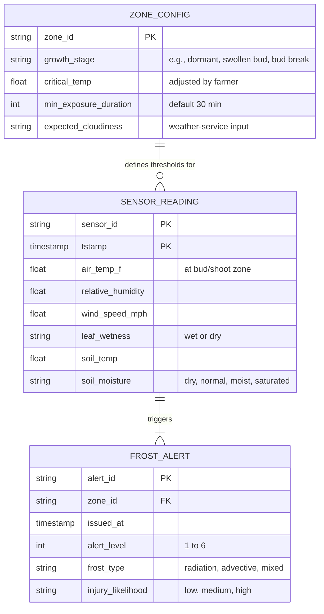
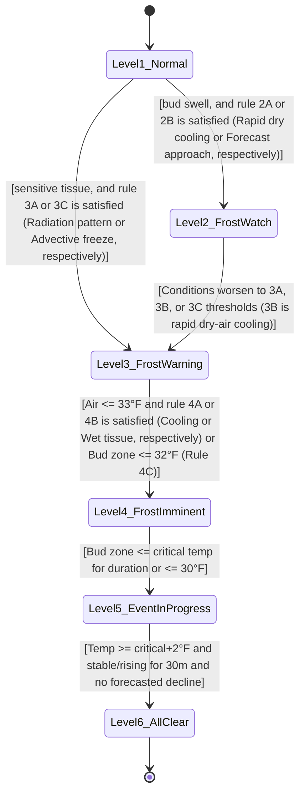

# Header, conventions, and D2 overview
**Project Title:** OMID AI-Based Farm Disease, Pest, Yield, and Frost Detection System

**Team Members:** Andrea Dall'Ara, Bridget Trout, Dang Luu, Cyrus Speicher

**Goal Statement:** Help crop farmers make timely, informed decisions by combining stationary sensor readings and drone imagery to assess frost, disease, and pest risks, estimate crop 
yield, and provide organized records for planning and research.

# Finished components, the D2 diagrams

## For the Frost Prediction Engine (Rule-based Model)
### Data Model

### Behavior (State Machine):
Every 15 minutes the following derived variables are calculated by the engine: 
**Cooling rate:** calculated over previous timeframes 
$$CoolingRate_{60} = T_{now} - T_{60min}$$ 
**Dew point (magnus approximation):** Where a = 17.625 and b = 243.04°C 
$$\gamma = \ln\left(\frac{RH}{100}\right) + \frac{aT}{b+T}$$ 
$$T_d = \frac{b\gamma}{a-\gamma}$$ 
**Dew point spread:** 
$$DewPointSpread = T_{air} - T_{dewpoint}$$ 
**Projected temperature:** 
$$T_{projected,2h} = T_{now} + 2(CoolingRate_{60})$$ 

Each rule has specified thresholds for measurements (either derived variables or sensor readings)

### Interface (I3):
**Endpoint:** internal method call 
**Inputs:** JSON array with the last 6 hourly sensor reading objects and the zone config thresholds 
**Outputs:** JSON array with alert level, frost type, injury likelihood, zone id 
**Errors:** Returns an error if there are fewer than two data points provided or the historical database is unreachable 

# Edge cases and error handling

# Requirements traceability table

# Design rationale

# AI Attribution
The authors would like to acknowledge the use of Gemini, 
developed by Google, in the preparation of this assignment. 
Gemini was used in the following way(s) in this assignment: 
Style and layout of the mermaid data model and the mermaid
behavior state machine diagram for the frost engine.
