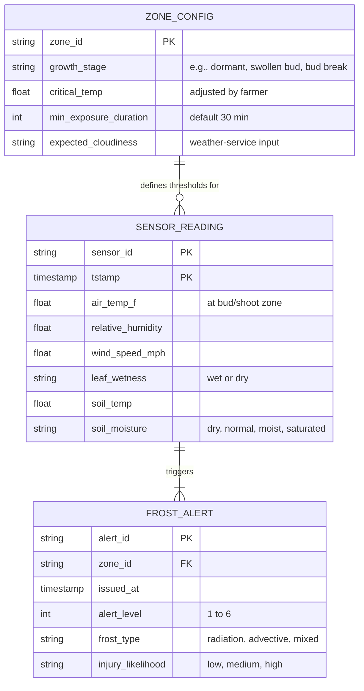
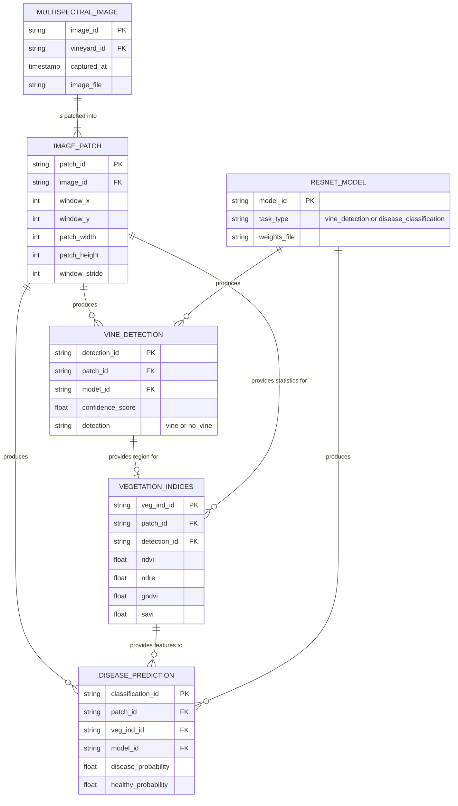
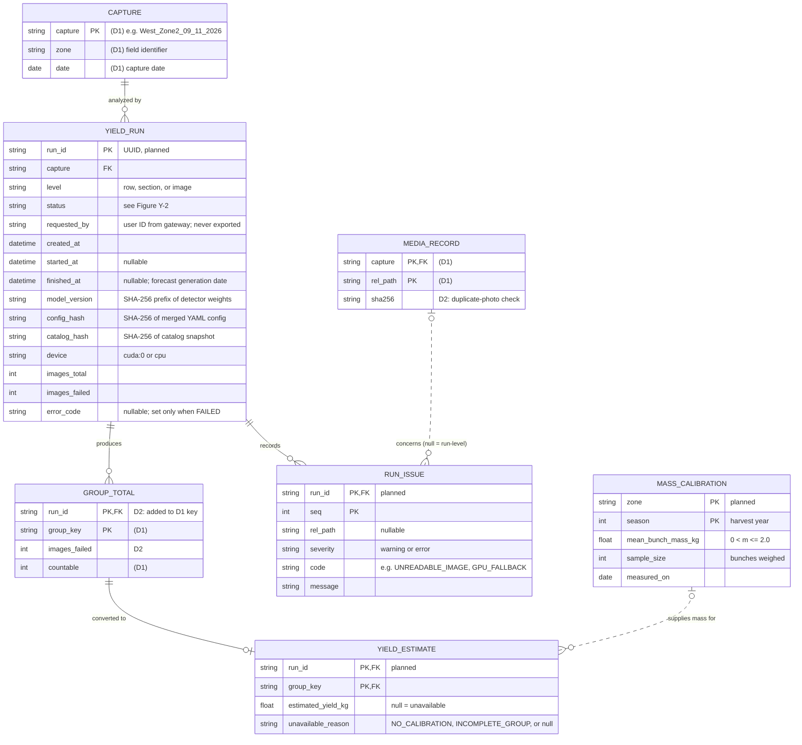
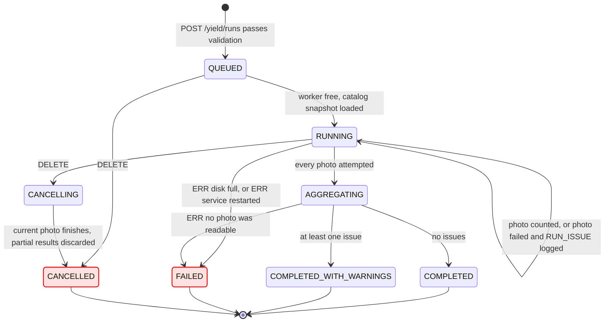
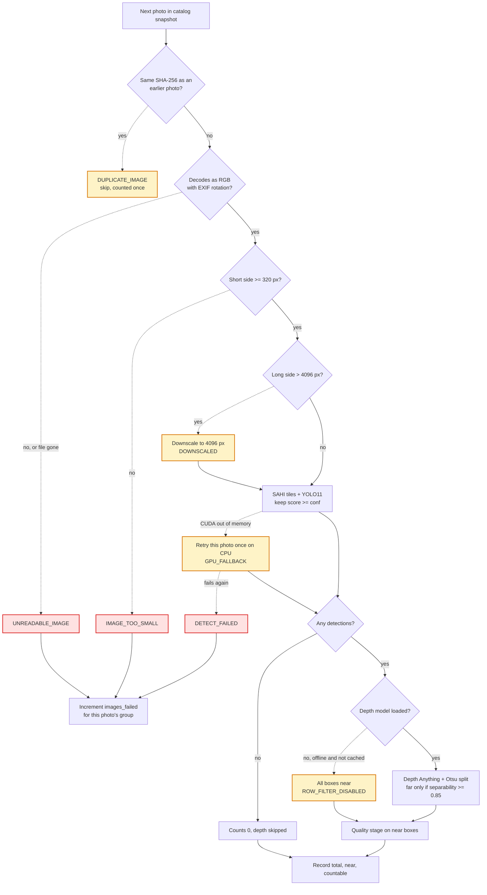

# Header, conventions, and D2 overview
**Project Title:** OMID AI-Based Farm Disease, Pest, Yield, and Frost Detection System

**Team Members:** Andrea Dall'Ara, Bridget Trout, Dang Luu, Cyrus Speicher

**Goal Statement:** Help crop farmers make timely, informed decisions by combining stationary sensor readings and drone imagery to assess frost, disease, and pest risks, estimate crop 
yield, and provide organized records for planning and research.

## Known gaps and open questions

**Yield Estimation**
- The I6 service, run queue, `YIELD_RUN`, and `RUN_ISSUE` are designed in D2 but not yet built. Today the module is the command-line batch `scripts/run_pipeline.py`.
- Converting counts to kilograms needs `MASS_CALIBRATION`: bunches weighed at the farm for each zone and season. Open question for OMID: who weighs, how many bunches, and when before harvest?
- Bunches that appear in two overlapping photos are counted twice (EC-Y16). The capture protocol must avoid overlap until tracking exists.
- Count accuracy and run time are estimates, not measurements. User_Stories has no accuracy or time target, so we propose AC-02.3 and a run-time NFR (see yield traceability).
- Open question for the web-app owner: where are crop type and harvest period stored for the buyer export (AC-04.1)?
- Open question for the disease owner: the D1 `CaptureResponse` returns server-local directory paths. The revised I6 avoids this, and the same may be wanted for I4.

# Finished components, the D2 diagrams

## For the Frost Prediction Engine (Rule-based Model)
### Data Model
**Frost Data Model Conventions**

| Figure element | Meaning |
|---|---|
| Box | One entity. The title is the entity name; each line inside is one key attribute. |
| `PK`, `FK` | Primary key, foreign key. |
| Solid line | Identifying relationship (the child cannot exist without the parent). |
| Dashed line | Non-identifying relationship. |
| Line ends (crow's foot) | Cardinality: `\|\|` exactly one, `o\|` zero or one, `\|{` one or more, `o{` zero or more. |

**Project Title:** OMID AI-Based Farm Disease, Pest, Yield, and Frost Detection System<br>
**Goal Statement:** Help crop farmers make timely, informed decisions by combining stationary sensor readings and drone imagery to assess frost, disease, and pest risks, estimate crop yield, and provide organized records for planning and research.


### Behavior (State Machine):
Every 15 minutes the following derived variables are calculated by the engine:<br>
**Cooling rate:** calculated over previous timeframes<br>
$$CoolingRate_{60} = T_{now} - T_{60min}$$<br>
**Dew point (magnus approximation):** Where a = 17.625 and b = 243.04°C<br>
$$\gamma = \ln\left(\frac{RH}{100}\right) + \frac{aT}{b+T}$$<br>
$$T_d = \frac{b\gamma}{a-\gamma}$$<br>
**Dew point spread:**<br>
$$DewPointSpread = T_{air} - T_{dewpoint}$$<br>
**Projected temperature:**<br>
$$T_{projected,2h} = T_{now} + 2(CoolingRate_{60})$$<br>

**Frost State Machine Conventions**

| Figure element | Meaning |
|---|---|
| Black circle | The initial or terminal state of the system. |
| Gray rounded box | A specific operational alert level (state). |
| Red rounded box | An explicit error-handling or degraded state. |
| Solid arrow | A state transition triggered by new sensor readings or time passing. |
| Dashed arrow | An error path triggered by missing inputs, invalid boundary values, or timing timeouts |
| Text on arrow | The specific rule conditions and thresholds required to trigger the transition. |


**Project Title:** OMID AI-Based Farm Disease, Pest, Yield, and Frost Detection System<br>
**Goal Statement:** Help crop farmers make timely, informed decisions by combining stationary sensor readings and drone imagery to assess frost, disease, and pest risks, estimate crop yield, and provide organized records for planning and research.


```mermaid
flowchart TB
    %% Styling to mimic state machine shapes
    classDef state fill:#f3f4f6,stroke:#374151,stroke-width:2px,rx:10px,ry:10px;
    classDef errorState fill:#fee2e2,stroke:#dc2626,stroke-width:2px,rx:10px,ry:10px;
    classDef point fill:#000,stroke:#000,rx:20px,ry:20px;

    Start((( ))):::point
    End((( ))):::point

    L1["Level 1: Normal"]:::state
    L2["Level 2: Frost Watch"]:::state
    L3["Level 3: Frost Warning"]:::state
    L4["Level 4: Frost Imminent"]:::state
    L5["Level 5: Event In Progress"]:::state
    L6["Level 6: All Clear"]:::state

    ErrData["Invalid Data Handler"]:::errorState
    ErrSensor["Degraded Alert State<br>(Sensor Unavailable)"]:::errorState

    Start --> L1

    %% Main Happy Path (Solid lines force the central vertical layout)
    L1 -->|Bud swell+ & Rapid cooling| L2
    L1 -->|Sensitive tissue & Advective/Radiation| L3
    L2 -->|Worsens to L3 thresholds| L3
    L3 -->|Air <= 33°F OR Bud <= 32°F| L4
    L4 -->|Bud <= Critical OR <= 30°F| L5
    L5 -->|Temp >= Critical+2°F & Stable| L6
    L6 --> End

    %% Bad Input / Boundary Values (Dashed lines push to the side)
    L1 -.->|Invalid Data OR Spread < -0.2°F| ErrData
    L2 -.->|Invalid Data| ErrData
    L3 -.->|Invalid Data| ErrData
    ErrData -.->|Reject & flag quality| End

    %% Missing Input / Timing Constraints (Dashed lines push to the side)
    L1 -.->|Missed 2 intervals| ErrSensor
    L2 -.->|Missed 1 interval| ErrSensor
    L3 -.->|Missed 1 interval| ErrSensor
    L4 -.->|Sensor failure| ErrSensor
    L5 -.->|Sensor failure| ErrSensor
    ErrSensor -.->|Data restored| L5
```

Each rule has specified thresholds for measurements (either derived variables or sensor readings)

### Interface (I3):
**Endpoint:** internal method call<br>
**Inputs:** JSON array with the last 6 hourly sensor reading objects and the zone config thresholds<br>
**Outputs:** JSON array with alert level, frost type, injury likelihood, zone id<br>
**Errors:** Returns an error if there are fewer than two data points provided or the historical database is unreachable<br>


## Disease Prediction Engine

| Figure element | Meaning |
|---|---|
| Box | An entity. The title is the entity name and each line inside is one attribute. |
| `PK`, `FK` | Primary key, foreign key. |
| Solid line | Identifying relationship. |
| Dashed line | Non-identifying relationship. |
| Line ends (crow's foot) | Cardinality: `\|\|` exactly one, `o\|` zero or one, `\|{` one or more, `o{` zero or more. |



## Yield Estimation Module

D1 gave this module a data model (D1 figure "Data model, Yield Estimation") and its two core algorithms (D1 Core algorithms 5 and 6). D1 did not cover how the web app starts a count and gets the result back, what happens over the life of a counting run, or how a photo that fails is reported. D1 left one open item: a corrupt photo stopped the whole run. D2 adds a run record with an issue log, a run lifecycle, a revised I6 interface, and a decision for every failure path. Items marked "planned" are designed but not yet in code. Today the module runs as the command-line batch `scripts/run_pipeline.py` in `grapevision/`.

### Data model (Figure Y-1)

**Figure Y-1 conventions:** the same as the D1 Yield Estimation figure conventions (box = entity, `PK`/`FK`/`UK` keys, solid line = identifying, dashed line = non-identifying, crow's-foot ends for cardinality, "planned" = not yet in code). Entities marked "(D1)" are shown only with the attributes needed to read the new relationships. Their full attribute lists are in D1.

**Project Title:** OMID AI-Based Farm Disease, Pest, Yield, and Frost Detection System<br>
**Goal Statement:** Help crop farmers make timely, informed decisions by combining stationary sensor readings and drone imagery to assess frost, disease, and pest risks, estimate crop yield, and provide organized records for planning and research.


| Structural decision | Reason |
|---|---|
| A `YIELD_RUN` entity holds each counting run. | A count is only meaningful with the model, configuration, and photo set that produced it. Recording `model_version`, `config_hash`, and `catalog_hash` on the run meets the constraints-essay requirement to retain configuration and model versions so a result can be traced. It also lets the module return the existing run when the same request arrives twice (EC-Y17). |
| `GROUP_TOTAL` is keyed by `(run_id, group_key)`, not `group_key` alone. | D1 assumed one count per group. Re-running a capture after retraining must not overwrite the earlier figure, because research exports (AC-05.1) need both. This supersedes the D1 key; D1 itself is unchanged. |
| `RUN_ISSUE` is a separate log, zero-or-many per run. | Failures are per photo: one corrupt file must not stop a 2,200-photo run (EC-Y9). The log feeds the warnings shown to the farm worker, and a null `rel_path` marks run-level issues such as `ROW_FILTER_DISABLED`. |
| Bunch mass moves from configuration into `MASS_CALIBRATION`, keyed by zone and season. | Mean bunch mass changes with the vineyard block and the year. A single config value would apply one block's mass to another. Storing `sample_size` and `measured_on` shows how much the figure can be trusted. |
| Storage stays as flat files per run (`outputs/runs/<run_id>/run.json`, `issues.csv`, `per_image.csv`, `per_<level>.csv`; `calibration.csv`). | D1's flat-file decision still holds: one writer, a few thousand rows per season. The web app copies the finished run summary into Firestore `yield_runs/{run_id}` so the dashboard can stream it the same way it streams `captures`. |

### Behavior: run lifecycle (Figure Y-2)

**Figure Y-2 conventions:**

| Figure element | Meaning |
|---|---|
| Filled black dot, ringed dot | Start and end of a run's life. |
| Rounded box | A value of `YIELD_RUN.status`. The status is stored, so a client can poll it. |
| Red box | A terminal state with no count result. |
| Arrow | A transition. The label gives the event that causes it; a label starting with `ERR` is an error path. |
| Self-loop on `RUNNING` | One photo was processed, whether it succeeded or failed. |

**Project Title:** OMID AI-Based Farm Disease, Pest, Yield, and Frost Detection System<br>
**Goal Statement:** Help crop farmers make timely, informed decisions by combining stationary sensor readings and drone imagery to assess frost, disease, and pest risks, estimate crop yield, and provide organized records for planning and research.


Checks that are cheap (the capture exists, its name gives a zone and date, it holds at least one supported photo, the model is loaded) run before a run is created. These failures return an error at once and never enter `QUEUED`. One GPU worker takes runs from a first-in, first-out queue. On startup, any run left in `RUNNING` or `CANCELLING` is set to `FAILED` with `error_code = INTERRUPTED`.

### Behavior: per-photo processing with error paths (Figure Y-3)

This is the riskiest flow in the module. Each photo depends on two models, the GPU, and the file itself. D1 Core algorithm 5 gives the happy path; this figure adds what happens when a step fails.

**Figure Y-3 conventions:**

| Figure element | Meaning |
|---|---|
| Rectangle | A processing step. |
| Diamond | A decision; the outgoing arrows are labeled with the answer. |
| Solid arrow | Normal path. |
| Dashed arrow | Error or fallback path. |
| Amber box | Degraded: the photo is still counted and a warning `RUN_ISSUE` is logged. |
| Red box | Failed: the photo is left out of the count and an error `RUN_ISSUE` is logged. The text gives the issue code. |

**Project Title:** OMID AI-Based Farm Disease, Pest, Yield, and Frost Detection System<br>
**Goal Statement:** Help crop farmers make timely, informed decisions by combining stationary sensor readings and drone imagery to assess frost, disease, and pest risks, estimate crop yield, and provide organized records for planning and research.


After every photo is attempted, `aggregate` sums each group, and the yield step runs for each group:

```text
If the group has images_failed > 0:  estimated_yield_kg = null, reason INCOMPLETE_GROUP (count still shown, flagged)
Else if no MASS_CALIBRATION for (zone, season):  estimated_yield_kg = null, reason NO_CALIBRATION
Else:  estimated_yield_kg = countable x mean_bunch_mass_kg   (0 countable gives 0 kg, a real zero)
```

### Interface (I6, revised)

**Revision of the D0 I6 row.** D0 had I6 take "Field Images" and return "crop count, estimated yield", failing "if imagery is too poor to analyze". Four changes:

| D0 I6 | D2 I6 | Why |
|---|---|---|
| Request carries the field images. | Request carries a `capture_id`. Photos are uploaded once through I1. | Sending 22 to 2,200 photos again for every run would repeat I1 and double the upload over a weak vineyard connection. |
| Detector settings were unstated, so a client could expect to pass them. | No model settings in the request: `conf`, tile size, device, and separability are server configuration, recorded in `config_hash`. | `conf` is tuned on the val split (D1 Core algorithm 6). Letting a client change it produces counts that cannot be compared with each other. Too many parameters, and they leak internals. |
| One synchronous response. | `202 Accepted` with a `run_id`, then the client polls. | A 2,200-photo run takes up to about 55 minutes on a GPU, far longer than any HTTP timeout. The disease service runs within the request because one capture is 5 TIFFs; yield runs cannot. |
| One "imagery too poor" failure. | Per-photo `Issue` records plus run-level error codes. | A run should not fail because of one bad photo. The farm worker needs to know which files to retake (AC-02.2). |

The response also leaves out server-local paths and per-detection internals (`features`, depth values). The D1 disease `CaptureResponse` still returns local directory paths; we flag this for the disease owner as an open question in the overview.

**Authentication.** I6 is internal. The gateway authenticates the user and checks their role (US-03), then calls I6 with a shared service token in `Authorization: Bearer <token>` and the user's ID in `X-Request-User`. The yield service stores no roles. Because the gateway checks the role on every request, a revoked permission takes effect on the next call (AC-03.2).

**Notifications.** The yield service does not push. The web app polls `GET /yield/runs/{run_id}` every 5 seconds while a run is active, then copies the terminal state into Firestore, where the dashboard stream picks it up.

**Configuration.** The configuration is layered: package defaults, then the project YAML, then overrides (D1 build-versus-reuse table). It is checked once at startup by `load_config` and `build_pipeline`. An unknown `row_filter.method` or `quality.method`, or a `conf` outside [0, 1], stops the service from becoming ready (EC-Y15). Bunch mass is not part of this configuration; it is data, set through `PUT /yield/calibrations` below.

**Logging.** Each run writes `run.json` (the `YIELD_RUN` record) and `issues.csv` (its `RUN_ISSUE` rows). Service log lines are JSON objects that carry `run_id`, so one run's history can be followed across the log.

**Endpoints** (base path `/yield`; all planned). The error body is `{success: false, code: string, error: string}`, the same shape as the pest and history services in D1 with a machine-readable `code` added.

| Method / route | Input | Success | Errors |
|---|---|---|---|
| `POST /yield/runs` | JSON `RunRequest`. | `202`: `RunStatus` for a new run. `200`: `RunStatus` of the existing run when the same capture, level, catalog, config, and model are already queued, running, or completed (EC-Y17). | `400 INVALID_LEVEL`; `401 UNAUTHORIZED`; `404 CAPTURE_NOT_FOUND`; `422 CAPTURE_NAME_INVALID` (no zone or date in the name); `422 NO_SUPPORTED_IMAGES` (message lists accepted formats JPEG and PNG); `429 QUEUE_FULL` with `Retry-After`; `503 MODEL_UNAVAILABLE`. |
| `GET /yield/runs/{run_id}` | Path `run_id`. | `200`: `RunStatus`. | `401`; `404 RUN_NOT_FOUND`. |
| `GET /yield/runs/{run_id}/results` | Path `run_id`. | `200`: `RunResult`, only for `COMPLETED` or `COMPLETED_WITH_WARNINGS`. | `401`; `404 RUN_NOT_FOUND`; `409 RUN_NOT_FINISHED` (body includes `status`); `409 RUN_FAILED` (body includes `error_code`). |
| `GET /yield/runs/{run_id}/annotated/{rel_path}` | Path `run_id`, `rel_path`. | `200`: JPEG with near, far, and countable boxes drawn. | `401`; `404` for an unknown run or a photo with no annotated output. |
| `DELETE /yield/runs/{run_id}` | Path `run_id`. | `202`: `RunStatus` with `CANCELLING` or `CANCELLED`. | `401`; `404 RUN_NOT_FOUND`; `409 RUN_ALREADY_FINISHED`. |
| `PUT /yield/calibrations/{zone}/{season}` | JSON `Calibration`. | `200`: the stored `Calibration`. | `400 INVALID_MASS` when the mass is not in (0, 2.0] kg or `sample_size` < 1; `401`. Role check (`canManageSites`) is done by the gateway. |
| `GET /yield/health` | None. | `200`: `{ready: true, model_version: string, device: string}`. | `503`: `{ready: false, reason: "MODEL_UNAVAILABLE" or "CONFIG_INVALID"}`. |

**Data types.**

| Type | Fields |
|---|---|
| `RunRequest` | `capture_id: string`, `level?: "row" \| "section" \| "image"` (default `"row"`). |
| `RunStatus` | `run_id: string`, `capture_id: string`, `level: string`, `status: string` (Figure Y-2), `created_at: string`, `started_at: string\|null`, `finished_at: string\|null`, `images_total: integer`, `images_done: integer`, `images_failed: integer`, `model_version: string`, `device: string`, `error_code: string\|null`, `issue_count: integer`. |
| `RunResult` | `run: RunStatus`, `zone: string`, `capture_date: string` (ISO date), `groups: GroupResult[]`, `issues: Issue[]`. |
| `GroupResult` | `group_key: string`, `images: integer`, `images_failed: integer`, `total: integer`, `near: integer`, `countable: integer` (all ≥ 0), `estimated_yield_kg: number\|null`, `unavailable_reason: "NO_CALIBRATION" \| "INCOMPLETE_GROUP" \| null`. |
| `Issue` | `rel_path: string\|null`, `severity: "warning" \| "error"`, `code: string`, `message: string`. |
| `Calibration` | `mean_bunch_mass_kg: number`, `sample_size: integer`, `measured_on: string` (ISO date). |

**Internal signatures added in D2** (D1 signatures for `CountingPipeline.run` and `aggregate` are unchanged):

- `RunQueue.submit(capture_id: str, level: str, user: str) -> tuple[RunStatus, bool]`. The boolean is `True` for a new run. Raises `CaptureNotFound`, `InvalidCaptureName`, `NoSupportedImages`, `QueueFull`, or `ModelUnavailable`; the HTTP layer maps each to the codes above.
- `PhotoWorker.process(record: MediaRecord) -> ImageResult | Issue`. Never raises for a bad photo; it returns an `Issue` instead. It raises only `StorageError`, which fails the run.
- `estimate_yield(group: GroupTotal, calibration: MassCalibration | None) -> tuple[float | None, str | None]`. Returns `(kg, None)` or `(None, reason)`.

**Example.** `POST /yield/runs` with `{"capture_id": "West_Zone2_09_11_2026", "level": "row"}` returns `202` and a `run_id`. When the run finishes, `GET /yield/runs/{run_id}/results` returns (abridged):

```json
{
  "run": {"run_id": "3f2c...", "status": "COMPLETED_WITH_WARNINGS", "images_total": 22, "images_failed": 1, "model_version": "a91be0c2", "device": "cuda:0"},
  "zone": "West_Zone2",
  "capture_date": "2026-09-11",
  "groups": [
    {"group_key": "West_Zone2_09_11_2026/row5", "images": 11, "images_failed": 0, "total": 312, "near": 240, "countable": 171, "estimated_yield_kg": 29.07, "unavailable_reason": null},
    {"group_key": "West_Zone2_09_11_2026/row7", "images": 11, "images_failed": 1, "total": 287, "near": 221, "countable": 160, "estimated_yield_kg": null, "unavailable_reason": "INCOMPLETE_GROUP"}
  ],
  "issues": [
    {"rel_path": "row7/Section3/sequence2.jpg", "severity": "error", "code": "UNREADABLE_IMAGE", "message": "cannot identify image file"}
  ]
}
```

The example values are illustrative, assuming a calibrated mass of 0.17 kg; they are not measured results.

# Edge cases and error handling

**Frost prediction:**
| ID | Component | Category | Edge Case | Design Decision | Handler | Recoverable |
| :--- | :--- | :--- | :--- | :--- | :--- | :--- |
| EC-F1 | Frost Engine | Missing Input | Primary temperature sensor fails during an active warning. | Retain the current alert, display "Sensor data unavailable," and show timestamp of latest measurement. | `AlertDowngradeGuard` | Yes |
| EC-F2 | Frost Engine | Timing / Missing Input | Missing reporting intervals. | Mark data stale after 2 missed intervals (Normal) or 1 interval (Watch+). Do not downgrade an alert for stale data. | `StaleDataMonitor` | Yes |
| EC-F3 | Frost Engine | Bad Input | Relative humidity or temperature is outside valid range. | Do not calculate dew point from invalid temperature or humidity. | `DewPointCalculator` | Yes |
| EC-F4 | Frost Engine | Boundary Value | Dew-point spread is highly negative (<-0.2°F). | Treat as a likely sensor error or mismatched measurements; trigger a data-quality flag. | `SpreadValidator` | Yes |
| EC-F5 | Frost Engine | Boundary Value | Soil is saturated. | Do not automatically reduce frost risk, as drainage and root health become separate concerns. | `RiskModifier` | Yes |

**Yield estimation:** handler names refer to the classes in the I6 internal signatures and in D1 Core algorithm 5. Figure Y-3 draws the per-photo rows (EC-Y5, Y6, Y9, Y13, Y25, Y26), and Figure Y-2 draws the run-level failures.

| ID | Component | Category | Edge Case | Design Decision | Handler | Recoverable |
| :--- | :--- | :--- | :--- | :--- | :--- | :--- |
| EC-Y1 | Yield Estimation | Boundary Value | Capture holds no photo in a supported format (empty folder, or only videos or HEIC). | Surface an error: `422 NO_SUPPORTED_IMAGES`, no run created, message names the accepted formats and asks for new photos. No count or yield is shown (AC-02.2). | `RunQueue.submit` | Yes, resubmit with JPEG or PNG photos |
| EC-Y2 | Yield Estimation | Boundary Value | A photo has zero detections. | Valid count of 0; the depth model is skipped. Not an error. | `PhotoWorker` | Not an error |
| EC-Y3 | Yield Estimation | Boundary Value | Fewer than two boxes in a photo, all boxes at the same depth, or a box with no depth value (NaN). | Otsu separability is 0, so every box stays near; a NaN box is near. The filter removes a bunch only with evidence of a second row. | `DepthRowFilter` | Yes, may overcount |
| EC-Y4 | Yield Estimation | Boundary Value | A detection score exactly equals `conf`. | Kept (`>=`), so results are deterministic. | `CountingPipeline.run` | Not an error |
| EC-Y5 | Yield Estimation | Boundary Value | Photo from a different camera with a long side over 4096 px. Tile count grows with area: about 300 tiles at 8000×6000. | Degrade: downscale to 4096 px on the long side before tiling and log `DOWNSCALED`. Small bunches may be missed. | `PhotoWorker` | Yes |
| EC-Y6 | Yield Estimation | Boundary Value | Photo with a short side under 320 px (thumbnail or crop). | Leave the photo out and log `IMAGE_TOO_SMALL`. Its group is marked incomplete. | `PhotoWorker` | Yes, retake the photo |
| EC-Y7 | Yield Estimation | Boundary Value | Bunch mass missing for the zone and season, or submitted as ≤ 0 or > 2.0 kg. | Out of range: reject with `400 INVALID_MASS`. Missing: yield is null with `NO_CALIBRATION` and shown as unavailable, never 0 (AC-04.2). | `CalibrationStore`, `estimate_yield` | Yes, enter a calibration and re-run |
| EC-Y8 | Yield Estimation | Boundary Value | All photos read but 0 countable bunches. | Real zero: report 0 kg, which is different from null "unavailable". | `estimate_yield` | Not an error |
| EC-Y9 | Yield Estimation | Bad / Missing Input | Corrupt or truncated photo, or a file deleted after the catalog snapshot. | Degrade: log `UNREADABLE_IMAGE` with the file name, leave it out, and continue the run. The group's count is shown with a warning, and its yield is null `INCOMPLETE_GROUP`. This closes the D1 open item where one bad file stopped the run. | `PhotoWorker` | Yes, retake and re-run |
| EC-Y10 | Yield Estimation | Bad / Missing Input | Mix of supported and unsupported files (HEIC from an iPhone, TIFF, video). | Skip the unsupported files when cataloging and log one `UNSUPPORTED_FORMAT` warning per file. If none remain, EC-Y1 applies. | `scan_capture` | Yes |
| EC-Y11 | Yield Estimation | Bad / Missing Input | Capture folder name does not match `<zone>_<MM>_<DD>_<YYYY>`, or has an impossible date. | Surface an error: `422 CAPTURE_NAME_INVALID`. A count without a field ID and date cannot meet AC-02.1. | `RunQueue.submit` | Yes, rename the folder |
| EC-Y12 | Yield Estimation | Bad / Missing Input | Photos are not in `rowN/SectionM` folders, but row totals were requested. | Fall back to image-level groups and log a run-level `NO_ROW_STRUCTURE` warning. Row totals are not invented. | `MediaRecord.group_key` | Yes |
| EC-Y13 | Yield Estimation | Bad / Missing Input | The same photo appears twice (copied into two section folders). | Count it once (matching SHA-256) and log `DUPLICATE_IMAGE`. | `PhotoWorker` | Yes |
| EC-Y14 | Yield Estimation | Bad / Missing Input | `level` is not `row`, `section`, or `image`. | Surface an error: `400 INVALID_LEVEL`. | `RunQueue.submit` | Yes |
| EC-Y15 | Yield Estimation | Bad / Missing Input | Invalid configuration: unknown stage method, or `conf` outside [0, 1]. | The service refuses to become ready, and `/health` returns `503 CONFIG_INVALID`. No run uses a half-valid configuration. | `load_config`, `build_pipeline` | Yes, after the config is fixed and the service restarted |
| EC-Y16 | Yield Estimation | Bad / Missing Input | Consecutive shots overlap, so one bunch appears in two photos. | Known limitation, not detected: `aggregate` assumes shots do not overlap. Documented in the capture protocol, and tracking across video frames is planned. Listed in the overview gaps. | `aggregate` | No, overcounts silently |
| EC-Y17 | Yield Estimation | Timing / Concurrency | Same request sent twice (double-click, client retry) while a matching run is queued, running, or done. | Return the existing run with `200` and start no second GPU job. "Matching" means the same capture, level, `catalog_hash`, `config_hash`, and `model_version`. | `RunQueue.submit` | Yes |
| EC-Y18 | Yield Estimation | Timing / Concurrency | Several different runs requested while the single GPU is busy. | Queue first-in, first-out with one worker. Over 20 queued runs, return `429 QUEUE_FULL` with `Retry-After`. | `RunQueue` | Yes, retry later |
| EC-Y19 | Yield Estimation | Timing / Concurrency | Photos added to or removed from the capture folder while a run is active. | The run uses the catalog snapshot taken when it was submitted (`catalog_hash`). New photos need a new run; removed photos fall under EC-Y9. | `RunQueue`, `PhotoWorker` | Yes |
| EC-Y20 | Yield Estimation | Timing / Concurrency | Service crashes or restarts during a run. | On startup, mark `RUNNING` and `CANCELLING` runs `FAILED` with `INTERRUPTED`, and discard partial totals. No automatic retry, because a crash may come from the photo itself. | `StartupRecovery` | Yes, manual resubmit |
| EC-Y21 | Yield Estimation | Timing / Concurrency | A run takes longer than an HTTP timeout (up to about 55 min for 2,200 photos). | Never process within the request: `202` and polling (Interface I6). | `RunQueue` | Not an error |
| EC-Y22 | Yield Estimation | Timing / Concurrency | Cancel arrives while a photo is being processed. | Move to `CANCELLING`, finish the current photo, then `CANCELLED` with partial results discarded. A cancelled run never shows a count. | `PhotoWorker` | Yes |
| EC-Y23 | Yield Estimation | Timing / Concurrency | Bunch mass is changed after a run has finished. | Finished runs keep the yield computed with the mass at aggregation time, because results do not change after the fact. A re-run uses the new mass. | `estimate_yield` | Yes |
| EC-Y24 | Yield Estimation | External Dependency | No CUDA GPU at startup (driver missing, laptop without GPU). | Degrade to CPU and report `device: "cpu"` in `/health` and `RunStatus`. Expect about 1 to 2 h for 2,200 photos (D1 complexity). | `build_pipeline` | Yes |
| EC-Y25 | Yield Estimation | External Dependency | GPU runs out of memory on a photo. | Fall back: retry that photo once on CPU and log `GPU_FALLBACK`. A second failure logs `DETECT_FAILED` and leaves the photo out (EC-Y9 rules apply). | `PhotoWorker` | Yes |
| EC-Y26 | Yield Estimation | External Dependency | Depth Anything weights are not cached and Hugging Face is unreachable (field laptop offline). | Degrade: row filter becomes `none`, all boxes are near, and a `ROW_FILTER_DISABLED` warning is logged on the run. Counts may include the row behind. Install pre-caches the weights. | `build_pipeline` | Yes, cache weights and re-run |
| EC-Y27 | Yield Estimation | External Dependency | Detector weights file missing or corrupt. | Surface an error: the service is not ready, and `POST` returns `503 MODEL_UNAVAILABLE`. No fallback to the generic `yolo11m.pt`, whose COCO classes include no grape bunch. | `build_pipeline` | Yes, restore the weights |
| EC-Y28 | Yield Estimation | External Dependency | Disk full while writing run outputs. | `FAILED` with `STORAGE_ERROR`; nothing partial is published. | `RunStore` | Yes, free space and resubmit |
| EC-Y29 | Yield Estimation | External Dependency | Web app cannot reach I6, or its Firestore write fails. | Results stay in the yield run store. The web app retries the idempotent `GET` with backoff (5, 10, 20, 40 s, then every 60 s) and shows "result pending", not a stale count. | Web app `YieldRunPoller` (to agree with the web-app owner) | Yes |

# Requirements traceability table

**Frost prediction:**
| ID | Short Text | Priority | Design Elements | How it is satisfied | Gap Explanation |
| :--- | :--- | :--- | :--- | :--- | :--- |
| R-F1 | Distinguish frost mechanisms | High | `frost_type` in `FROST_ALERT`, Rules 3A and 3C | Wind speeds classify the event (e.g., > 10 mph signals an advective freeze). | None |
| R-F2 | Calculate dew point accurately | High | `DewPointCalculator`, Magnus approximation | Uses air temperature and humidity internally in Celsius to compute dew point. | None |
| R-F3 | Prevent false all-clears | High | State Machine `Level6_AllClear` transition | Prevents lowering alert until temp is 2°F above threshold, stable for 30 mins, with no forecasted decline. | None |
| R-F4 | Localized sensor targeting | Med | `SENSOR_READING.air_temp_f` | Evaluates temperatures measured specifically at the grape bud/shoot zone, rather than generic box temperatures. | None |
| R-F5 | Retain configuration history | Med | `ZONE_CONFIG` historic logs | Timestamps and stores farmer configurations with growth stage, preceding values, and outcomes for local calibration. | None |

**Yield estimation:** requirement IDs are the acceptance criteria in User_Stories. `NFR-` rows come from the constraints essay. "Figure Y-n" and `EC-Yn` refer to the yield sections above, and "D1 Algorithm n" refers to D1 Core algorithms.

| ID | Short Text | Priority | Design Elements | How it is satisfied | Gap Explanation |
| :--- | :--- | :--- | :--- | :--- | :--- |
| AC-02.1 | Show a nonnegative whole-number count and an estimated yield with its unit, field ID, and capture date, with no manual counting | High | `POST /yield/runs`; `GroupResult.countable` and `estimated_yield_kg`; `RunResult.zone` and `capture_date` from `CAPTURE`; D1 Algorithm 5; Figures Y-2 and Y-3; EC-Y2, EC-Y11 | One request starts the count. Counts are sums of detection lists, so they are integers ≥ 0. The unit is fixed in the field name (`_kg`). Zone and date are parsed from the capture name, and a capture without them is refused (EC-Y11). | Partial. Yield in kg needs `MASS_CALIBRATION`, which is planned and needs bunches weighed at the farm. "Countable" uses the size baseline until the fullness CNN is trained. Count accuracy has not been measured on the test split. |
| AC-02.2 | Explain why analysis cannot proceed when no image is readable, and show no count | High | `422 NO_SUPPORTED_IMAGES`; `FAILED` state in Figure Y-2; `Issue` and `RUN_ISSUE`; EC-Y1, EC-Y9, EC-Y10 | No supported photo: refused before a run exists, with the accepted formats listed. No readable photo: the run ends `FAILED` and `/results` returns `409 RUN_FAILED`, so no count is available. Some unreadable: the files are named and their groups' yield is null. | None |
| AC-04.1 | Buyer export includes crop, field, harvest period, yield with unit, and generation date | Med | `YIELD_ESTIMATE.estimated_yield_kg`; `YIELD_RUN.finished_at` as the generation date; `CAPTURE.zone` | The yield module supplies yield, unit, field, and generation date in `RunResult`. The web app builds the export. | Gap: crop type and expected harvest period are not stored by the yield module. Proposed: both come from the web app's zone settings (open question for the web-app owner). Export format is out of this module's scope. |
| AC-04.2 | Label yield as unavailable instead of 0 or a substitute forecast | High | `estimated_yield_kg = null` with `unavailable_reason`; `estimate_yield`; `MASS_CALIBRATION` keyed by zone and season; EC-Y7, EC-Y8, EC-Y9 | Null and a reason, never 0. A real zero stays 0 kg (EC-Y8). Calibration is looked up only for the exact zone and season, so another field's mass is never substituted. | None in the module. The export label wording belongs to the web app. |
| AC-05.1 | Research CSV of yield records with anonymized field IDs and no account identifiers | Med | `per_<level>.csv` and `run.json` per run; `GROUP_TOTAL` keyed by `(run_id, group_key)` | Every run is kept, so a date range selects records by `CAPTURE.date`. Counts carry their run's model version. | Gap: `zone` is the farm's own name (e.g. `West_Zone2`). The anonymized mapping is applied by the web-app export. `YIELD_RUN.requested_by` must be excluded from it. The module stores no GPS location. |
| AC-03.1, AC-03.2 | Role-based access; a revoked permission is denied on the next request | High | I6 Authentication paragraph; `401 UNAUTHORIZED`; `X-Request-User` | I6 accepts only gateway calls with the service token. Role checks stay in the gateway on every request, so the module never holds stale permissions. | Gap: rotation of the service token is not designed yet (owner: web app). |
| NFR-SEC (traceability) | Retain configuration and model versions, logging, and data-quality indicators | High | `YIELD_RUN.model_version`, `config_hash`, `catalog_hash`, `device`; `RUN_ISSUE`; JSON log lines with `run_id` | Every count can be traced to its weights, configuration, and exact photo set. Every degraded or failed photo leaves a coded record. | None |
| NFR-ECON | Stay within the $2,000 budget (D0 DL-6) | High | CPU fallback (EC-Y24); D1 build-versus-reuse table | Runs on an owned 6 GB GPU or on CPU only; all dependencies are free. | Risk: Ultralytics is AGPL-3.0 (D1 license note). An RT-DETR fallback exists behind the same detector interface. |
| NFR-ENV | Work in a vineyard with an unreliable connection | Med | Pre-cached weights; offline fallback EC-Y26; `capture_id` instead of re-uploading photos (I6 revision) | A run needs no network once photos are uploaded. Losing the depth model degrades the count with a warning instead of failing. | None |
| NFR-SOC | Adaptable to new regions and crops | Low | `MASS_CALIBRATION` per zone and season; layered configuration; detector behind a callable interface | A new block or season needs only a calibration row. A new crop needs a new detector behind the same interface. | Gap: the detector is trained only on grape bunches. A new crop needs new labeled photos; there is no zero-shot path. |
| (none) | Run time for a capture | — | D1 Algorithm 5 complexity; EC-Y21, EC-Y24 | Designed for under 1 min per 22-photo capture on a GPU, run as a batch job. | Gap: no requirement states a time limit. We propose adding one (e.g., results within 1 hour of upload for one capture) and will measure before optimizing. |

**Reverse check, yield design elements to requirements.** Elements without a direct requirement:

| Design element | Requirement behind it | Decision |
|---|---|---|
| Row filter and quality stage (`DETECTION.row`, `quality`; D1 Algorithm 5) | AC-02.1 asks for "crop count" but not *which* bunches count. The sponsor's rule (near row, full bunches only) is not written in User_Stories. | Keep. Proposed new criterion AC-02.3: "the count excludes bunches on other rows and bunches the farm does not harvest." Without it this logic looks like scope creep. |
| Threshold tuning and count metrics (D1 Algorithm 6) | No accuracy target exists. | Keep, because it is how AC-02.1 counts are made trustworthy. Proposed NFR: count MAE target per photo on the test split, set after the first labeled test set. |
| `DETECTION.features` and the planned learned row filter | None directly. | Keep only `features`, since recording them is cheap. The learned filter is deferred until `row` labels exist and the Otsu baseline is measured. |
| Annotated photo endpoint | None. It supports trust in AC-02.1 ("without requiring manual counting"). | Keep as low priority; it is the first item to cut if time runs short. |
| Video frames and cross-frame tracking (planned, EC-Y16) | None. | Out of scope for now. Videos are skipped at cataloging; tracking returns only if overlap proves to be a measurable error. |
| Training, splitting, and CVAT tooling (`scripts/`) | None at runtime. | Kept as development tooling needed to produce the model, not a product feature. |

# Design rationale

These entries expand the significant D1 and D2 decisions. The architecture baseline remains in D0's **Decision log (DL-1 through DL-6)** and is referenced rather than repeated here.

## DR-01: Separate single-photo and multispectral disease workflows

We chose separate single-photo ViT and multispectral disease workflows over one shared inference pipeline because the photo model uses a 224×224 preprocessed image, while the multispectral model requires aligned bands, spectral indices, and seven-channel tiles. We accepted the trade-off of maintaining different preprocessing steps and response types because each workflow must preserve the input representation expected by its trained model.

**References:** D1, Core algorithms 1–2 and API contract (`/predict`, `/process-capture`); extends D0 DL-3's task-specific model boundaries.

## DR-02: Screen multispectral tiles for vines before disease analysis

We chose vine classification followed by disease analysis on overlapping 64×64 tiles over assigning one disease label to the entire capture because the staged approach focuses analysis on vine regions and produces a spatial heatmap. We accepted the trade-off of an additional classifier and missed disease when vine probability falls below 0.5 because the disease stage needs relevant plant regions rather than background imagery. The current `disease_detected: false` result when no vine tiles qualify remains a limitation; it does not establish that the crop is healthy.

**References:** D1, Core algorithm 2 and `InferenceSummary`; related D0 interface I4.

## DR-03: Aggregate historical readings in the backend

We chose scoped BigQuery queries and server-side time buckets over downloading all raw sensor records for browser-side aggregation because the dashboard requests specific organizations, sites, zones, readings, and date ranges. We accepted the trade-off of losing detail within each bucket and depending on the history service because selectable intervals and `AVG`, `MIN`, or `MAX` provide useful chart summaries without transferring every reading. This does not resolve D1's separately documented gaps in site/zone parentage validation or query limits.

**References:** D1, Core algorithm 4 and API contract (`HistoryRequest`, `HistoryResponse`, `/getHistoricalSeries`); builds on D0 DL-4.

## DR-04: Count bunches in side-view RGB photos

We chose bounding-box detection in side-view RGB photos over D0's multispectral segmentation approach because bunches hang below the canopy and the available farm photos and training datasets are RGB. We accepted the trade-off of requiring side-view capture coverage and obtaining boxes rather than precise masks because counting needs individual bunch instances and box annotation requires less labeling work. This is the design refinement already recorded in D1, not a newly attributed peer-review change.

**References:** D1, Core algorithm 5, “Change from D0”; refines D0's Yield Estimation description and I6 input assumptions.

## DR-05: Separate bunch detection, row filtering, and quality assessment

We chose detection followed by separate row and quality filters over a single detector trained to recognize a “countable” class because countability depends on row position and bunch fullness, which are difficult to learn together from the small labeled dataset. We accepted the trade-off of additional stages and configuration because each stage can be tested independently and the `total`, `near`, and `countable` counts show where bunches were excluded. The fullness CNN and conversion from counts to kilograms remain planned, as marked in D1.

**References:** D1, Core algorithm 5 and data-model entities `DETECTION`, `GROUP_TOTAL`, and `YIELD_ESTIMATE`; related D0 interface I6.

## DR-06: Use tiled detection with duplicate merging

We chose SAHI tiling with a whole-photo pass and duplicate-box merging over resizing each photo for one 640-pixel inference pass because shrinking a 1215-pixel-wide photo reduces the visibility of small bunches. We accepted the trade-off of seven detector passes for the example photo size and possible merging of touching bunches because retaining small-object detail supports more useful counts. D1's runtime estimates still require measurement, and merging within a photo does not solve duplicate counts across overlapping photos.

**References:** D1, Core algorithm 5, complexity estimate and duplicate-count edge cases; related D0 interface I6.

## DR-07: Separate rows using relative depth within each photo

We chose a per-photo Otsu split of relative bunch depths over a fixed depth cutoff or a netting-color rule because monocular depth values are not comparable across photos and many rows have no netting. We accepted the trade-off of retaining all detections as near when separability is below 0.85, or when depth is unavailable, because the filter should remove a bunch only when there is evidence of a distinct background row. Ambiguous images can therefore retain background bunches and overcount.

**References:** D1, Core algorithm 5, row-filter behavior and edge cases; consistent with D0 DL-6's existing-hardware constraint.

## DR-08: Tune the count threshold on validation data

We chose validation-set count MAE to select the detector confidence threshold over using the default cutoff, optimizing box F1 alone, or tuning on the test set because the required result is a bunch count and test-set tuning gives an optimistic evaluation. We accepted the trade-off of a threshold selected from a small validation sample and a wide uncertainty interval because keeping the test set independent provides a more credible assessment. Reporting box metrics and signed count bias alongside MAE exposes errors that aggregate counts can hide.

**References:** D1, Core algorithm 6 (`tune_threshold`, `count_metrics`) and its edge cases; supports the yield-counting use of I6.

## DR-09: Configure frost injury thresholds by zone and growth stage

We chose zone configuration containing growth stage, a farmer-adjusted critical temperature, and minimum exposure duration over one universal injury threshold because frost sensitivity changes with crop development and local conditions. We accepted the trade-off of requiring correct configuration and domain validation because the alert must reflect the crop's current vulnerability. This refines the rule-based baseline in D0 DL-2 rather than reopening the choice between rules and a trained model.

**References:** D2, `ZONE_CONFIG` data model and Interface I3; D0 DL-2.

## DR-10: Require sustained recovery before issuing all-clear

We chose the six-level frost lifecycle with a sustained all-clear condition over clearing an active event as soon as temperature crosses the critical threshold because a brief rise does not establish that the danger has passed. We accepted the trade-off of waiting until temperature is at least 2°F above the critical value, stable or rising for 30 minutes, with no forecasted decline because these conditions provide stronger evidence of recovery. I3's insufficient-data and database errors remain errors rather than evidence for an all-clear.

**References:** D2, Frost State Machine (`Level5_EventInProgress` to `Level6_AllClear`) and Interface I3; refines D0 DL-2 and DL-4.

# AI Attribution
The authors would like to acknowledge the use of Gemini, 
developed by Google, in the preparation of this assignment. 
Gemini was used in the following way(s) in this assignment: 
Style and layout of the mermaid data model and the mermaid
behavior state machine diagram for the frost engine.
