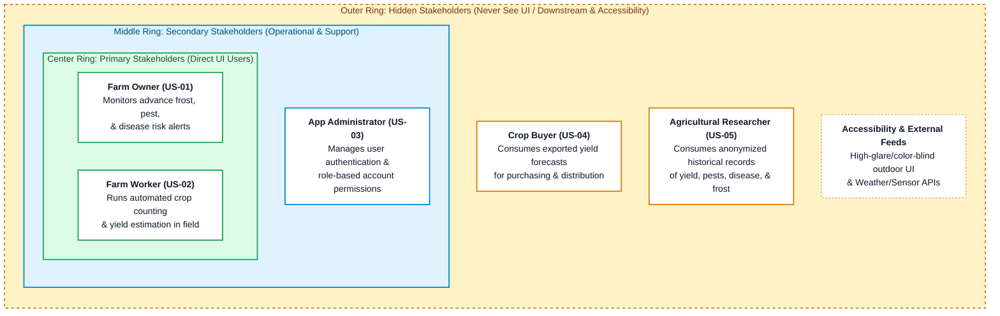

# Stakeholders
## Primary
- Farm owner
- Farm worker
 
## Secondary
- App administrator

## Hidden
- Crop buyer
- Agricultural researcher

## Stakeholder Map

# User Stories

## Farm owner
US-01 (Primary): As a farm owner, 
I want to know in advance when pests, disease, and frost will affect my crops, 
so that I can administer treatment only when necessary.  

AC-01.1  Given [starting context or precondition],
When  [the action the actor takes],
Then  [the verifiable outcome, with a number where one applies].

AC-01.2  Given [starting context or precondition],
When  [the action the actor takes],
Then  [the verifiable outcome, with a number where one applies].

### Use case draft
"Crop prediction"

Primary Actor: Farm owner

Secondary Actor: Web app, farm worker

Preconditions: 
Sensors are running and transmitting live information to the web app, 
prediction models are trained and finetuned to the specific crop field, 
the farm owner is logged in to the app.

Main success flow: 
1) Farm owner selects the disease event to be predicted. 
2) Web app uses sensor data to make a disease prediction and posts it to the screen.
3) Farm owner sees that black rot is highly likely to occur and takes preventative measures. 

Alternate success flow: 
1) Farm owner selects the disease event to be predicted. 
2) Web app uses sensor data to make a disease prediction and posts it to the screen.
3) Farm owner sees that crops are healthy and does not take preventative measures. 

Exception flow:
1) Farm owner selects the disease event to be predicted. 
2) Exception: Web app cannot access recent sensor data and states which sensors are down.

Postcondition:
Web app displays likelihood of disease, pest, and frost events. 

## Farm worker
US-02 (Primary): As a farm worker, 
I want automated crop counting and yield estimation, 
so that I save time from manually counting flower buds or early crop growth.

AC-02.1  Given [starting context or precondition],
When  [the action the actor takes],
Then  [the verifiable outcome, with a number where one applies].

AC-02.2  Given [starting context or precondition],
When  [the action the actor takes],
Then  [the verifiable outcome, with a number where one applies].

## App administrator
US-03 (Secondary): As an app administrator, 
I want user authentication and account permission management, 
so that I can only give access to privileged users. 

AC-03.1  Given [starting context or precondition],
When  [the action the actor takes],
Then  [the verifiable outcome, with a number where one applies].

AC-03.2  Given [starting context or precondition],
When  [the action the actor takes],
Then  [the verifiable outcome, with a number where one applies].

## Crop buyer
US-04 (Hidden): As a crop buyer, 
I want to know estimated crop yield, 
so that I can plan my purchasing and distribution.

AC-04.1  Given [starting context or precondition],
When  [the action the actor takes],
Then  [the verifiable outcome, with a number where one applies].

AC-04.2  Given [starting context or precondition],
When  [the action the actor takes],
Then  [the verifiable outcome, with a number where one applies].

## Agricultural researcher
US-05 (Hidden): As an agricultural researcher,
I want access to long term and organized records of crop yield, pests, disease, and frost, 
so that I can identify trends and factors affecting farms. 

AC-05.1  Given [starting context or precondition],
When  [the action the actor takes],
Then  [the verifiable outcome, with a number where one applies].

AC-05.2  Given [starting context or precondition],
When  [the action the actor takes],
Then  [the verifiable outcome, with a number where one applies].
