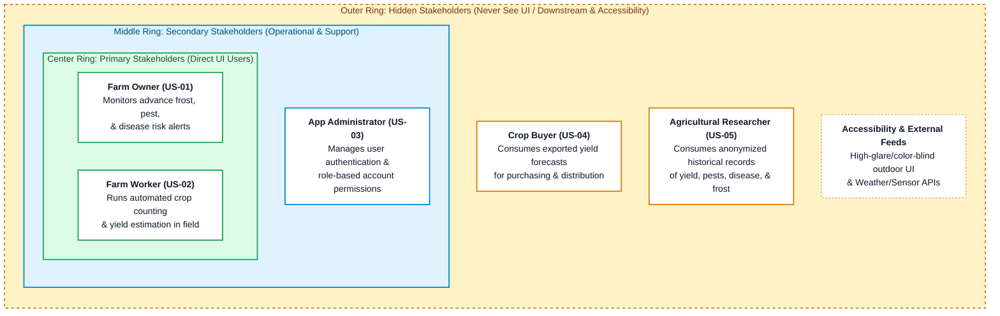

# User Stories
Team members: Andrea Dall'Ara, Bridget Trout, Cyrus Speicher, Dang Luu

# Stakeholders
## Primary
- Farm owner
- Farm worker
 
## Secondary
- App administrator

## Hidden
- Crop buyer
- Agricultural researcher

## Stakeholder Map

# User Stories

## Farm owner
US-01 (Primary): As a farm owner, 
I want to know in advance when pests, disease, and frost will affect my crops, 
so that I can administer treatment only when necessary.  

AC-01.1  Given the farm owner is logged in, recent sensor data is available for the selected field, and a prediction model is configured for the selected pest, disease, or frost event,  
When the farm owner selects the field and event and requests a prediction,  
Then the app displays the predicted likelihood, the time period covered by the prediction, the affected field, and the timestamp of the sensor data used.

AC-01.2  Given the farm owner is logged in and one or more sensors required for the selected prediction have no data within the configured freshness limit,  
When the farm owner requests the prediction,  
Then the app identifies each sensor with missing or outdated data and states that a current prediction cannot be generated, without presenting an older prediction as current.

### Use case draft
"Crop prediction"

Primary Actor: Farm owner

Secondary Actor: Web app, farm worker

Preconditions: 
Sensors are running and transmitting live information to the web app, 
prediction models are trained and finetuned to the specific crop field, 
the farm owner is logged in to the app.

Main success flow: 
1) Farm owner selects the disease event to be predicted. 
2) Web app uses sensor data to make a disease prediction and posts it to the screen.
3) Farm owner sees that black rot is highly likely to occur and takes preventative measures. 

Alternate success flow: 
1) Farm owner selects the disease event to be predicted. 
2) Web app uses sensor data to make a disease prediction and posts it to the screen.
3) Farm owner sees that crops are healthy and does not take preventative measures. 

Exception flow:
1) Farm owner selects the disease event to be predicted. 
2) Exception: Web app cannot access recent sensor data and states which sensors are down.

Postcondition:
Web app displays likelihood of disease, pest, and frost events. 

## Farm worker
US-02 (Primary): As a farm worker, 
I want automated crop counting and yield estimation, 
so that I save time from manually counting flower buds or early crop growth.

AC-02.1  Given the farm worker is logged in and a supported set of crop images is available for a selected field with a configured crop-counting and yield-estimation model,  
When the farm worker starts automated analysis,  
Then the app displays the detected crop or flower-bud count as a nonnegative whole number and the estimated yield with its unit, field identifier, and image capture date, without requiring manual counting.

AC-02.2  Given the farm worker is logged in and the submitted image set contains no readable images in a supported format,  
When the farm worker starts automated analysis,  
Then the app explains why analysis cannot proceed and prompts the worker to submit supported images, without displaying a crop count or yield estimate for the failed analysis.

## App administrator
US-03 (Secondary): As an app administrator, 
I want user authentication and account permission management, 
so that I can only give access to privileged users. 

AC-03.1  Given the administrator has enabled an account and assigned it a role,  
When the account holder submits valid login credentials,  
Then the app authenticates the account holder and grants access only to the fields and functions permitted by the assigned role.

AC-03.2  Given the administrator is logged in and an existing account has access to a restricted function,  
When the administrator removes that permission and saves the change,  
Then the updated permission is retained and the account is denied access on its next request to that function, including requests from an already active session or a direct URL.

## Crop buyer
US-04 (Hidden): As a crop buyer, 
I want to know estimated crop yield, 
so that I can plan my purchasing and distribution.

AC-04.1  Given a yield forecast is available for a selected crop, field, and harvest period,  
When an authorized farm owner exports the forecast for a crop buyer,  
Then the exported report includes the crop, field, expected harvest period, estimated yield with its unit, and forecast generation date, and can be read without an app account.

AC-04.2  Given no yield forecast is available for the crop, field, and harvest period selected for a buyer report,  
When an authorized farm owner exports the report,  
Then the report labels the yield estimate as unavailable for that selection instead of reporting zero or substituting a forecast from another crop, field, or harvest period.

## Agricultural researcher
US-05 (Hidden): As an agricultural researcher,
I want access to long term and organized records of crop yield, pests, disease, and frost, 
so that I can identify trends and factors affecting farms. 

AC-05.1  Given historical yield, pest, disease, and frost records are stored and an authorized farm owner has selected a date range for a research export,  
When the farm owner exports the records for an agricultural researcher,  
Then the app produces a CSV containing every matching record and no records outside the selected range, with dates, crop types, consistent anonymized field identifiers, record types, and recorded values with units where applicable; the export excludes names, contact details, precise farm locations, and account identifiers and can be read without an app account.

AC-05.2  Given no historical records exist within the selected date range,
When an authorized farm owner requests a research export,
Then the app displays “No records found for the selected date range,” generates no export file, and allows the owner to select a different date range.

# AI Attribution
The authors would like to acknowledge the use of Gemini, 
developed by Google, in the preparation of this assignment. 
Gemini was used in the following way(s) in this assignment: 
Style and layout of the mermaid stakeholder map. 