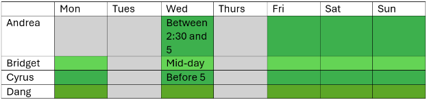

# Team Contract 
OMID AI-Based Farm Disease, Pest, Yield, and Frost Detection System

Team Members: Andrea Dall'Ara, Bridget Trout, Dang Luu, Cyrus Speicher

## Senior Design Goals
All members agree to performing their best on the project to not inhibit team members from meeting the following personal goals: 

* Andrea: Gain useful web development and team building experience through project work 
* Bridget: Get an A in senior design class. Apply my ML knowledge to a new domain (agriculture). Finish with a strong project to add to my resume. 
* Cyrus: Gain useful machine learning and software development experience through project work 
* Dang: Gain useful computer vision skills and teamwork.

## Meeting Norms 
* Weekly status meeting with the full team and Advisor Dr. Mohsen to discuss progress. All members should attend. 
* Ad hoc meetings to discuss challenges or closely collaborate. 
* Weekly CS team standups before the full weekly status meeting may be necessary as the project ramps up. All members should agree to schedule and meet if necessary. 
* Meeting note-taker: Bridget Trout 

## Work Norms 
All members are expected to...

* Contribute to their assigned task as listed in the roles spreadsheet. 
* Collaborate across the project as needed.  
* Attend meetings and give weekly updates. 
* Perform on their tasks and produce deliverables. If tasks/deliverables are repeatedly not followed through on after team intervention and intervention from our advisor Dr. Mohsen, the team will bring concerns to Prof. Zhan and a grade reduction may be administered. 

## Decision Making 
In the case where a decision must be agreed upon by the team, majority vote decision wins. The group voting may be just the CS team or the full team depending on the level of the decision. In a stalemate, the CS team leader Hoang decides. 

## Holidays / Vacation
Members are not expected to work on these holidays or vacation days: 

* Thanksgiving break: Thursday, November 26 - Sunday, November 29 
* Winter break: December 5, 2026 - January 10, 2027 
* Spring break: March 15 - Sunday, March 21, 2027 

## Availability 
High level weekly availability to meet/work on the senior design project 

## Agreement Signatures 

Bridget Trout 

Cyrus Speicher 

Andrea Dall'Ara 

Dang Luu 